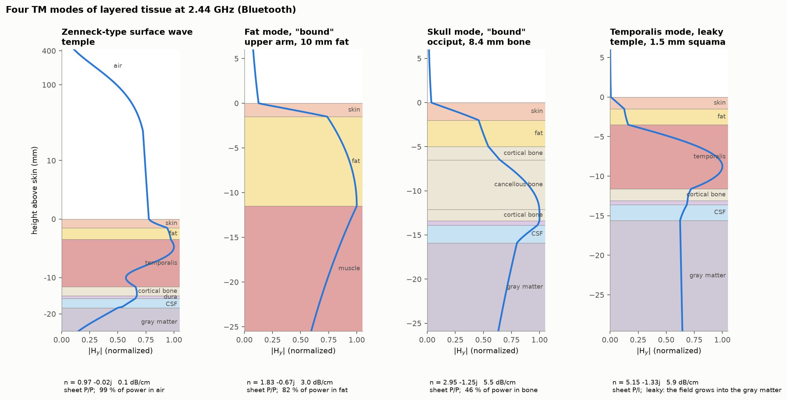
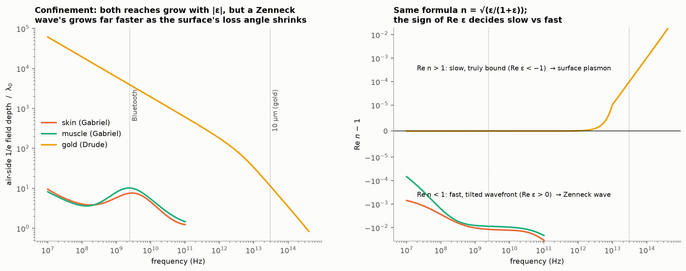
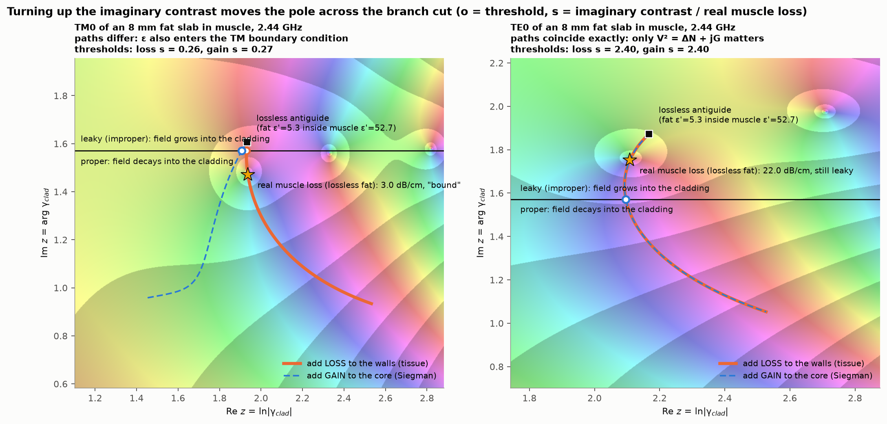
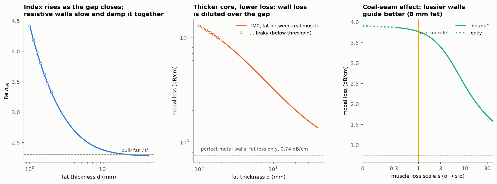
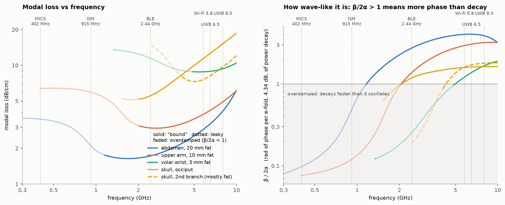
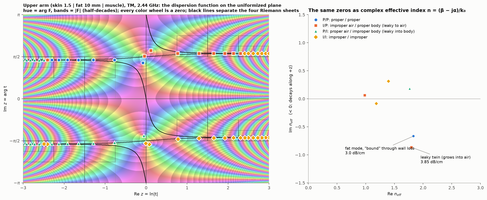
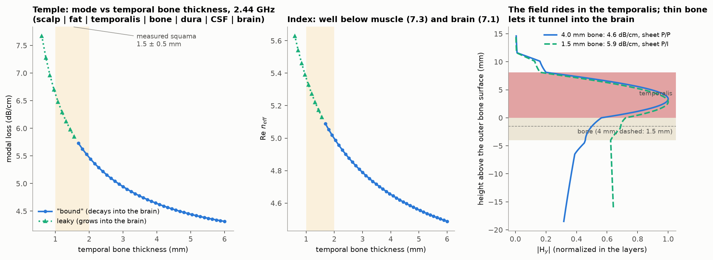

# Appendix: mode catalog

Planar (1D) layered-tissue stacks, TM unless noted, 2.44 GHz (Bluetooth) unless noted. Every mode is a zero of the multilayer dispersion function F, which is the same thing as a pole of the stack's spectral response to a source (F is that response's denominator). Modes are found with the argument-principle solver in [tissue-slab-modes](../README.md) and classified by Riemann sheet: **P/P** = proper on both sides (bound, Re γ > 0), **I/P** = grows into the air (leaky to air), **P/I** = grows into the body side (leaky into the body), **I/I** = improper on both sides. Tissue permittivities: 4-pole Cole-Cole (Gabriel et al. 1996). Regenerate the figures with `python scripts/make_figures.py [--eps]`.

The modes' effective index, loss, sheet and power share are given throughout the README (mainly section 8); the sections below add the per-mode detail and prior art for all five modes and for the leaky twin.

Whether a pole actually appears in the field of a small source is a separate question from being a zero of F; the README's section 2 walks the branch-cut argument. One refinement belongs here: an improper pole counts only if it lies between a half-space's Sommerfeld cut and its vertical cut, and a proper pole lying there is hidden anyway (Tamir & Oliner, *Proc. IEE* 110:310 (1963)). `results/residues.md` has the numerical proof: for buried sources in all three stacks, the swept poles (14–19 per stack) plus the two cut integrals reproduce the exact field at z = 6 cm to 5.2 × 10⁻¹⁰, and adding any of the named uncaptured poles, or removing the named guided mode, breaks the match by seven to eleven orders of magnitude.



**Figure 10.** Four TM modes of layered tissue at 2.44 GHz (Bluetooth): the Zenneck-type surface wave, the "bound" fat mode, the "bound" occipital skull mode, and the temporalis mode leaking into the brain through 1.5 mm of bone. Each panel shows |H_y| against height, normalized, with the mode's index, loss and power share noted below. The transverse field profile of each mode in the `results/modes.md` table, one PNG apiece, is **Figure 11**, in `figures/modes/<id>.png`.

---

## The equations we solve

The layers are stacked along x, the wave travels along z as exp(j(ωt − k₀nz)), lossy media have Im ε < 0, and lengths are scaled by k₀ (ξ = k₀x). In a layer of permittivity εⱼ the transverse field is A exp(γⱼξ) + B exp(−γⱼξ) with γⱼ = √(n² − εⱼ). The state vector u = [H_y, (1/ε) dH_y/dξ] (TM) or u = [E_y, dE_y/dξ] (TE) is continuous at every interface, and a layer of thickness dⱼ carries it from its bottom to its top by

$$M_j=\begin{pmatrix}\cosh\phi_j & p_j\,\sinh\phi_j/\gamma_j\\ \gamma_j\,\sinh\phi_j/p_j & \cosh\phi_j\end{pmatrix},\qquad \phi_j=\gamma_j k_0 d_j,\quad p_j=\varepsilon_j\ (\mathrm{TM})\ \text{or}\ 1\ (\mathrm{TE}).$$

In the bottom half-space the field is exp(+γ_b ξ), so u starts as (1, γ_b/p_b); above the top interface it is exp(−γ_t ξ). Carrying u up through all N layers and matching it to the top half-space gives the dispersion function

$$F(n)=\frac{\gamma_t}{p_t}\,u_1+u_2=0,\qquad \begin{pmatrix}u_1\\u_2\end{pmatrix}=M_N\cdots M_1\begin{pmatrix}1\\ \gamma_b/p_b\end{pmatrix}.$$

Every entry of Mⱼ is an even function of γⱼ, so the interior layers add no branch points; only γ_t and γ_b are double-valued, and the sign choices Re γ ≷ 0 on each side give the four sheets P/P, I/P, P/I and I/I. Because γ_t² − γ_b² = ε_b − ε_t = C is constant, the substitution γ_t = (√C/2)(t + 1/t), γ_b = (√C/2)(t − 1/t) makes F single-valued in t, and the solver finds every zero inside its search window with the argument principle on the plane z = ln t (four-sheeted relation: Smith, Houde-Walter & Forbes, *IEEE J. Quantum Electron.* 28(6):1520–1526 (1992), [doi:10.1109/3.135305](https://doi.org/10.1109/3.135305); single-valued unfolding: Smith, Forbes & Houde-Walter, *IEEE J. Quantum Electron.* 29(4):1031–1034 (1993), [doi:10.1109/3.214486](https://doi.org/10.1109/3.214486); argument principle: Anemogiannis & Glytsis, *J. Lightwave Technol.* 10(10):1344–1351 (1992), [doi:10.1109/50.166774](https://doi.org/10.1109/50.166774)). The field of a line source is a spectral integral over n whose integrand has F(n) in its denominator, so each zero of F is a pole of that integrand, and its residue is the mode's contribution; the derivation is in Chew, *Waves and Fields in Inhomogeneous Media* (1990; IEEE Press reprint), ch. 2, [doi:10.1109/9780470547052](https://doi.org/10.1109/9780470547052), and the implementation in `tissue_slab_modes/dispersion.py` of the solver.

---

## 1. Zenneck-type surface wave

**What it is.** A TM wave "bound" to the skin surface and carried almost entirely in the air: 99 % of its power is outside the body. Over a plain skin half-space (n = 0.988 − 0.003j, 0.01 dB/cm) the field falls to 1/e about 93 cm into the air (7.6 free-space wavelengths); over the layered temple stack (n = 0.973 − 0.023j, 0.10 dB/cm) it reaches only about 22 cm (1.8 wavelengths), still with 99 % of its power in the air. Re n < 1, so its phase speed along the surface exceeds c because its wavefront tilts into the tissue.

**Why it's cool.** It is the same pole formula as a surface plasmon: n = √(ε/(1+ε)) for both. The sign of Re ε decides which one you get. Gold at optical frequencies (Re ε < −1) gives a slow, tightly bound plasmon; skin at 2.4 GHz (Re ε > 0, large |ε|) gives a fast, loosely "bound" Zenneck wave. On confinement alone, skin at Bluetooth behaves like gold at about 6.5 µm, where gold's field also reaches 7.6 free-space wavelengths into the air (Figure 3). It has the lowest loss of any mode here, but a small source on or near the skin does not launch it; a large aperture shaped to its profile launches a Zenneck-like field, but only near the aperture (Hill & Wait 1980). On the temple stack the pole is proper (P/P) but lies under the air's Sommerfeld cut (Re n < 1, Im n < 0), outside what the field integral sweeps, so it drops out of the field (and on the arm and occiput stacks the surface pole sits on I/P with Im n > 0). What runs along the skin from an ordinary antenna is the Norton ground wave plus the space wave, the classic resolution of the Zenneck controversy (Collin 2004; Michalski & Mosig 2016). For a source 1 mm above the skin, these branch-cut waves carry most of the surface field 6 cm away; the guided tissue mode still carries 11–21 % of the surface |H_y| on the arm (the fat mode) and about 2 % or less on the head (the skull and temporalis modes).

**Prior art.** Zenneck vs plasmon: Michalski & Mosig, *IEEE Antennas Propag. Mag.* 64(6):70–80 (2022). Patented launcher designs (their physics is disputed): CPG Technologies US 10,062,944 B2 and US 9,923,385 B2; experiment: Oruganti et al., *Sci. Rep.* 10:925 (2020) (over metal); theory: Hill & Wait 1980 (10 MHz over ground). Ear-to-ear hearing aids deliberately polarize normal to the head to couple into the around-head path: Starkey US 10,051,388 B2, GN ReSound EP 2871861. Tesla's patent for transmitting power through the ground and air, US 787,412 (1905, filed 1900), is a precursor that CPG's patents cite, though it describes stationary waves in the earth rather than a surface wave.



**Figure 3** (see the README for the caption).

## 2. The fat mode: lossy-wall loss guiding (the headline)

**What it is.** Fat (ε′ ≈ 5.3) is the *low*-index layer between skin (38) and muscle (53). That is an antiguide: total internal reflection cannot hold a wave in it. Instead, the large permittivity contrast with the wet skin and muscle walls reflects part of a grazing TM wave at each bounce, somewhat like a leaky parallel-plate waveguide — on the upper-arm stack it refracts into the muscle wall at 14.5° from the wall normal at each bounce — while the walls' **loss** absorbs the wave that refracts into them, moving the pole across the branch cut from leaky (improper) to mathematically "bound" (proper, P/P), with 82 % of its power in the fat and 3.0 dB/cm of loss on the 10 mm upper-arm stack. Following the Riemann-sheet classification, we call this **lossy-wall loss guiding** (or **"bound" through wall loss**). Nagel, Blair & Scarpulla (2011) used "loss-guided" for the reverse geometry, a lossy core between lossless walls; the tissue case puts the high permittivity and the loss in the walls.

**Why it's cool.**
- **It is the Riemann-sheet mirror image of Siegman's gain guiding, exact for TE and nearly so for TM.** Take a symmetric 8 mm slab of *lossless* fat (ε = 5.3) in muscle (Figure 5). With lossless walls the mode is leaky. Scale the muscle loss by s: the pole crosses the branch cut at s = 0.26 and real muscle (s = 1) holds it "bound" (P/P) at 3.0 dB/cm. Adding *gain* to the core instead, as in Siegman's fibers, crosses at s = 0.27. For TE the two paths coincide exactly because only Siegman's complex contrast enters, V² = (k₀d/2)²(ε_core − ε_wall) = ΔN + jG for a core of thickness d, where ΔN < 0 marks an antiguide and G > 0 means the walls are lossier than the core or the core has gain (TM differs slightly because ε also enters the boundary condition). TE needs s = 2.40 at 8 mm, though: its field must nearly vanish at each high-permittivity wall, as between metal plates, so 8 mm is too thin to reach "bound" at real tissue loss — the crossing happens only above about 13 mm of fat (with fat's own loss included, s_th = 2.46, 1.21, 1.03, 0.89 at d = 8, 12, 13, 14 mm). The abdomen's 20 mm fat layer does carry a "bound" TE mode (2.1 dB/cm, 52 % of its power in the fat and 31 % in the air), but skin and air hold it from above, not a second wet wall; the symmetric 20 mm slab's TE₀ is "bound" yet overdamped (8.4 dB/cm).
- **High permittivity does most of the holding; lossier walls lower the loss.** Restoring fat's own 0.74 dB/cm loss (ε = 5.3 − 0.8j) in the symmetric 8 mm slab (Figure 6), even lossless muscle walls (s = 0) already hold the leaky mode to 3.91 dB/cm through partial grazing reflection. Turning on real muscle loss (s = 1) crosses the branch cut at s = 0.32 (against 0.26 for Figure 5's lossless fat) and makes the mode proper (P/P) at 3.77 dB/cm, refracting into the muscle wall at 19.3° from its normal at each bounce, and raising the wall loss further lowers the modal loss: 3.91 → 3.77 → 3.39 → 2.45 → 1.71 dB/cm for s = 0, 1, 3, 10, 30, heading toward the perfect-conductor limit of 0.74 dB/cm (Figure 6, right). This is the coal-seam effect from mining radio: a more conductive wall reflects more and keeps the field out, as a metal plate would.
- **Thinner fat behaves like a metal gap.** Re n rises from 2.29 (25 mm) to 4.42 (1 mm) as the gap closes, but the loss rises with it too, to 12.8 dB/cm (β/2α = 0.77): close, resistive walls slow the wave and damp it together — a lossy parallel-plate line, not the reactive slowing of a true metal-insulator-metal gap plasmon, since tissue never reaches Re ε < 0. Below about 4 mm the mode is heavily damped, and below about 2 mm it turns leaky (Figure 6, left and middle). The real upper-arm stack shares only the loss trend: from 10 to 8 mm of fat the loss rises from 3.0 to 3.6 dB/cm, but Re n falls (1.83 → 1.70) and the refraction angle in the muscle moves toward the wall normal (14.5° → 13.4°).
- **There is a best frequency.** In the abdomen (20 mm fat) the loss has a minimum of about 1.6 dB/cm near 1.7 GHz and stays below 1.75 dB/cm from 1.5 to 2.5 GHz. At low frequency the root survives but is overdamped: β/(2α) = Re n / |2 Im n| < 1, where β/(2α) is the radians of phase per e-fold (4.34 dB) of power decay (oscillation Q-factor; faded in Figure 7). The mode becomes wave-like above about 1.2 GHz in the abdomen, 2.0 GHz in the upper arm and 5.0 GHz at the wrist.

**Prior art.** The subcutaneous fat channel itself is modeled and measured as a microwave dielectric waveguide by the Uppsala Fat-IBC group: Asan et al., *Healthc. Technol. Lett.* 4:115 (2017) and *Sensors* 18:2752 (2018); Rangaiah et al., *IEEE TBME* 71(1):89–96 (2024); Engstrand et al., EuMC 2025; Engstrand, PhD thesis, Uppsala (2026). Sensing patents and applications: Probingon AB US 12,357,187 B2; Meaney, Augustine et al. (Uppsala) EP 4 044 914 A1 (withdrawn); Samsung US 2016/0143558 A1 (UWB fat-layer reflectometry). Coal-seam modes in mining geophysics: Emslie & Lagace, *Radio Sci.* 11:253 (1976); Hill, *J. Res. NBS* 89:385 (1984); Wait, *Radio Sci.* 11:263 (1976). Gain guiding: Siegman, *JOSA A* 20:1617 (2003), *JOSA B* 24:1677 (2007); US 7,668,211 B1. Loss-gain-loss non-Hermitian guiding: Savoia, Castaldi & Galdi, *PRA* 94:043838 (2016). We take the term "loss-guided" from Nagel, Blair & Scarpulla, *Opt. Express* 19:20159–20171 (2011), who use it, following Siegman (2003), for the reverse geometry (lossy core, lossless walls); we credit and distinguish it. While Fat-IBC models fat as a dielectric waveguide channel, we found no prior work giving the Riemann-sheet synthesis that links fat and skull modes to Siegman's gain-guided antiguides, coal-seam modes, and Nagel's loss-guided thin films.



**Figure 5** (see the README for the caption).



**Figure 6** (see the README for the caption).



**Figure 7** (see the README for the caption).

## 3. The leaky twin: a zero that is not a wave

**What it is.** A second zero next to the fat mode, on the I/P sheet (n = 1.797 − 0.866j, 3.85 dB/cm): the same fat-guided profile, but it grows into the air.

**Why it's cool.** It makes the four Riemann sheets concrete. On the uniformized plane (Figure 2) every color wheel is a zero, and the black curves separating the sheets pass right between the "bound" mode and its twin. It is also the cleanest example that a zero is not automatically a wave. The twin is slower than light in air (Re n = 1.80 > 1), and a slow wave cannot leak into air, so no source excites it. The exact field of a source in the fat matches the captured poles plus the branch-cut waves, with no twin term. The sheet label alone can't tell you this; where the pole sits relative to the branch cuts can.



**Figure 2** (see the README for the caption).

## 4. The skull mode: lossy-wall loss guiding (back of the head / occiput)

**What it is.** The same mechanism in bone. At the back of the head (occiput) the skull is thick (8.4 mm: 1.5 mm outer cortical table, 5.6 mm cancellous diploë, 1.3 mm inner cortical table), and bone (ε′ ≈ 11–19), under 3 mm of fat, forms a low-index layer between the scalp and dura (42), CSF (66) and brain (49). The mode is "bound" (P/P): 46 % of its power is in bone and it loses 5.5 dB/cm.

**Why it's cool.** It is a bone-guided radio mode, the electromagnetic counterpart of what bone-anchored hearing aids do acoustically. The field peaks at the inner table, against the dura/CSF, refracting into the gray matter at 24.5° from the normal at each bounce. β/(2α) ≈ 1.2 at 2.44 GHz, so it is only just wave-like. Its loss is lowest (about 5.1 dB/cm) near 1.8 GHz, just inside its overdamped range; it becomes wave-like only above about 2 GHz. On this branch the loss reaches 11.4 dB/cm at 5.8 GHz. A second "bound" mode, overdamped at Bluetooth, loses less than the first branch above 4.0 GHz (8.2 dB/cm at the crossing, 7.6 dB/cm at 5.8 GHz; dashed in Figure 7) and, still overdamped at its own roughly 4.0 GHz crossing (β/2α = 0.83), becomes wave-like in its own right only above about 4.3 GHz — but it is carried mostly by the fat over the bone (56 % fat, 37 % bone at 5.8 GHz), not by bone like the first branch (63–88 % bone from 4.0 to 7.99 GHz).

**Prior art.** None found for an EM skull-guided mode as such. Data links through the skull bone between hearing devices use vibration instead: Cochlear US 9,191,759 B2 (bone-conduction data link). RF links into the brain through the skull are being studied directly (Särestöniemi et al. 2022); a related but distinct application delivers wireless neuromodulation through an implanted microwave split-ring resonator rather than a data link (Boston University, US 2023/0140692 A1).

**3D check.** Earlier runs of cases A and B used lossless tissue and their numbers were wrong. The corrected, lossy-tissue results — the skull mode launched alone at the back of the head toward the right ear (Figure 9) — are in the README's section 9; the raw numbers are in `results/case_a_mode/case_a_mode_res2.json` and `results/case_a/case_a_res2.json`. Right at Ernie's posterior midline launch ray, the 9.2 mm three-layer bone has much thicker cortical tables and a thinner diploë than the generic stack, which, together with Ernie's thicker skin and thinner fat, lowers the 1D loss to 4.4 dB/cm (n = 2.917 − 0.984j) against 5.5 dB/cm for the generic occipital stack; it also sits over the venous sinus (`blood`) rather than CSF and brain — replacing the sinus with a generic dura/CSF/gray-matter base under Ernie's own bone gives 4.2 dB/cm, so the sinus itself adds only about 0.2 dB/cm. In 3D the mode survives along the curving skull, losing 3.2–3.7 dB/cm after beam-spreading correction (16–28 % below the 4.4 dB/cm 1D prediction). That correction assumes a Gaussian beam with a 3 cm Rayleigh range and is worth 0.62/0.68/0.44 dB/cm over 1–2.5/2.5–6/6–12 cm. Uncorrected, the mid-bone field falls 4.2 dB/cm over 1–6 cm (21.1 dB total), matching the 1D rate, so over 1–6 cm the gap mostly reflects the assumed spreading; over 6–12 cm the field decays more slowly than 1D even uncorrected (3.6 dB/cm). A point-dipole source at the same spot, without the mode-matched launch sheet (`case_a`), cross-checks at 2.96–4.0 dB/cm after removing an assumed cylindrical spreading (worth 0.5–2.6 dB/cm). The local mid-bone phase index is 2.5–2.6 over 1–6 cm (12–15 % below the 1D value), rising to 2.95 (about 1 % above it) over 6–12 cm, where the bone thins from 6.6 to 3.5 mm, although in 1D thinner bone lowers the index (about 2.45 at 3.5 mm). "Bound" (P/P) here means the interior tissue absorbs the refracted leakage, not that the bone seals the power in.

## 5. Temporalis mode: "bound" to leaky as the temple thins

**What it is.** At the temple |H_y| peaks not in the bone but in the temporalis muscle (8.1 mm, index 7.3), which is the high-index layer between fat (2.3) and bone (3.4), so this is ordinary index guiding with a lossy core, though with 6 mm of bone about 36 % of the power still flows in the bone (40 % in the temporalis). The thin squama is only a low-index barrier between the muscle and the CSF/brain. Because gray matter's index (7.1) and CSF's (8.3) are above the mode's (~4.5–5.2), the wave tunnels through the bone into the brain, more strongly the thinner the bone: frustrated total internal reflection.

**Why it's cool.** The anatomy sits right on the threshold. The mode is "bound" (P/P) down to 1.64 mm of bone, and the measured adult squama is 1.52 ± 0.50 mm (Bhushal et al. 2025); loss and index change smoothly through that thickness, and nothing physically switches on there — it is only where the flat-layer sheet label flips. At 6 mm it is "bound" (4.49 − 0.97j, 4.3 dB/cm); at 1.5 mm it leaks into the brain (5.15 − 1.33j, 5.9 dB/cm; Figure 8). The same stack also holds a second P/I root at 4.81 − 0.29j (1.3 dB/cm) whose field doubles within 14 mm of brain. Its low dB/cm is irrelevant: the root sits above the brain's branch point, outside the region the field integral sweeps, so no source excites it. The temporalis mode, by contrast, is a genuine captured leaky wave, though only just: at its Im n the capture region begins at Re n = 6.633/1.331 = 4.984, and the mode sits at 5.151, a margin of 0.17.

**3D check.** At `case_c_left`'s launch point the bone reads 2.05 mm along the bone normal (the 1D prep stack) but 1.9 mm along the launch ray, both off the 0.5 mm voxel grid; `case_c_right`'s 3.0 mm matches exactly. The left margin over the "bound"/leaky threshold (1.70–1.75 mm) is 0.30–0.35 mm on the prep stack and about 0.15–0.20 mm along the ray, both below the 0.5 mm voxel, so the 3D grid cannot tell which side of the threshold the left launch spot is on; on this stack Re(n² − ε_bone) ≈ −1.6, so the bone is not even an evanescent barrier there.

**Prior art.** The around-head hearing-aid patents above. Nothing found on temporalis-guided or skull-tunneling modes.



**Figure 8** (see the README for the caption).

## 6. Truly bound: muscle in a limb

**What it is.** Muscle between fat and cortical bone/yellow marrow is a mode that is truly bound — evanescent on both sides (Re(n² − ε) > 0), an ordinary fiber-style index guide, not a lossy-wall antiguide (alongside the 7.99 GHz occipital CSF mode, n = 6.66 − 1.58j, 22.9 dB/cm). For 25 mm of muscle over 6 mm of cortical bone and a low-water yellow-marrow half-space (an assumed geometry), the TE mode at 2.44 GHz has n = 7.04 − 0.89j, 98 % of its power in the muscle, and loses 4.0 dB/cm; at 0.9 GHz 2.1 dB/cm, and at 0.4 GHz 1.5 dB/cm, though there it is barely a wave (β/2α = 1.2).

**Why it's cool.** None of the five standard flat stacks elsewhere in this catalog has a truly bound mode at or below 6.5 GHz, because their deepest half-space is high-index muscle or brain (and the 2 mm CSF layer is below its asymmetric-slab cutoff until about 6.65–6.9 GHz); the limb is the exception, with low-index yellow marrow inside the bone so no wetter layer beyond the muscle steals the mode. A truly bound mode rides in a wet layer and loses about that layer's own bulk loss (4.0 dB/cm against 3.87 dB/cm for muscle): low-loss layers are cheaper in bulk, but a mode held in them by wet walls pays mostly for leakage into those walls (1.7–3.0 dB/cm for the abdomen and arm fat modes, 5.5 for the skull, 11.5 at the wrist).

**Prior art.** A short, time-boxed search (five queries: limb/arm guided modes, muscle slab waveguide, muscle channel IBC at 2.4 GHz, arm as lossy cylinder, intramuscular/limb channel) found no paper or patent that frames limb muscle between fat and bone as an index-guided RF waveguide mode. The closest adjacent work treats muscle as a galvanic-coupling intra-body channel at 1 kHz–10 MHz (Qin et al., *Open Biomed. Eng. J.* 11:1 (2017), PubMed 28567127), not a guided mode.

## 7. The reverse geometry: a lossy core

Nagel, Blair & Scarpulla's (2011) own geometry swaps where the loss sits: a lossy core between lossless walls. Their "loss-guided" modes exist only because the film is lossy, and their effective index is below the walls', so total internal reflection does not hold them; the paper also finds an anti-guided mode in a lossy film of lower index than its walls. Tissue permittivities give two versions of a lossy core, at two frequencies.

At 7.99 GHz, muscle — the high-index layer — forms a 25 mm lossy core inside lossless fat walls. Its fundamental total-internal-reflection TM mode rides in the core and pays about muscle's own loss (n = 6.83 − 1.28j, 18.6 dB/cm). A different proper TM root loses far less: n = 2.089 − 0.032j, 0.47 dB/cm, with 99 % of its power in the lossless fat and only 1 % in the core. Its Re n is below fat's index (2.18), so the field in the fat is a wave heading toward the core, not an evanescent tail: the root is one of two coupled Zenneck-type surface waves on the fat | muscle faces, proper only because the core is lossy — the tissue version of Nagel et al.'s loss-guided modes. Restoring fat's own real loss (ε = 4.76 − 1.00j, 3.30 dB/cm in bulk) turns this pole improper at about 0.8–0.85 of that loss, as the single-interface Zenneck formula predicts: 0.47, 1.19, 1.91 dB/cm (still proper) at ×0, ×0.25, ×0.5, then improper at ×1 (3.34 dB/cm, close to fat's own bulk rate), where the field grows into the fat while its power still flows toward the muscle — wall loss *breaking* the proper mode here, the mirror image of the main thesis.

At 2.44 GHz the same question can be asked of fat itself, as an antiguide core: how much loss would fat need, alone, before a lossless-muscle | fat | lossless-muscle sandwich carries a proper TM mode, with no help from wall loss? The threshold core loss ε″ is 5.39 at 5 mm of fat, 3.50 at 8 mm and 2.82 at 10 mm of fat — a product ε″·d of about 28 mm across all three — 7.0, 4.6 and 3.7 times real fat's own ε″ ≈ 0.77. The root that turns proper there is a new, Nagel-type loss-guided root fed from the walls, not the leaky fat mode made proper (that one stays improper up to at least ε″ = 8). Real fat's own loss is far from enough on its own; in the tissue's actual geometry it is wall loss, not core loss, that moves the fat mode onto the proper sheet.

---

## Which source launches which mode

The full launch-share table (how much of the surface field |H_y| each mode's own residue term carries at 2 cm and 6 cm from a small electric line source, by source depth and orientation, plus the exactness checks) is in [`results/residues.md`](results/residues.md) and summarized in the README's section 2. In brief: a current inside the guiding layer and normal to it couples into the named mode most strongly (carrying −1.3 / −6.4 dB of the surface field at 2 / 6 cm on the upper arm, −6.1 / −15.0 dB at the occiput, and −12.1 / −28.5 dB at the temple); turning it tangential, or moving it 1 mm into the air above the skin, only costs 3–10 dB more of coupling into the mode itself. What actually collapses the mode's *share* of the surface field from air — down to −5.3 to −55.3 dB at 2 cm — is that an external source drives the air-side branch-cut waves so much harder, not weak coupling into the mode: with the source 1 mm above the skin and normal to the layer, that share is −17.6 dB on the arm, −34.3 dB at the occiput and −55.3 dB at the temple.

## Relatives (named in the post, not separate 1D modes here)

| relative | how it connects | computed? |
|---|---|---|
| Siegman gain-guided fiber | the mirror path in Figure 5 | yes (Figure 5) |
| surface plasmon (SPP) | same pole formula as Zenneck; sign of Re ε decides | yes (Figure 3) |
| MIM / gap plasmon | Re n rising as the fat gap closes (Figure 6, left); tissue never has Re ε < 0 | shape analogy only |
| coal-seam mode | lossier walls guide better (Figure 6, right) | yes (Figure 6) |
| lossy core (Nagel's own geometry) | the reverse of lossy-wall loss guiding; §7 above, "The reverse geometry: a lossy core" (both the 7.99 GHz Zenneck-type pair on the faces of a lossy muscle core in lossless fat and the low-index 2.44 GHz fat-in-muscle threshold ε″·d ≈ 28 mm) | yes — see `results/modes.md`'s threshold table (smallest fat ε″ at which lossless muscle \| fat \| lossless muscle carries a proper mode, by thickness and polarization) and its 7.99 GHz continuation: with fat's real loss restored the pair's pole turns improper (3.34 dB/cm, close to fat's own 3.30), its field growing into the fat while power still flows toward the muscle |
| Norton ground wave | not a mode (branch-cut contribution); with the space wave, much of what an antenna on or near the skin launches along it, the Norton part more strongly when the antenna is polarized normal to the skin (Grimm & Manteuffel 2014) | yes in 1D (`results/residues.md` cut integrals); partly in 3D — in case B (dipole 3 mm outside the skin behind the left ear) the air carries the signal around the head: the field is nearly uniform over the first 15 mm of air and 9–20 dB stronger 3 mm outside the skin than 1 mm inside (not fitted to a Norton model) |
| ARROW [Duguay et al., *Appl. Phys. Lett.* 49:13 (1986)] | thin high-index skin over low-index fat could act as an antiresonant reflector | no (not tested) |
| spoof SPP [Pendry et al., *Science* 305:847 (2004)] | needs corrugated conductors: body-worn textiles, Tian et al. *Nat. Electron.* 2:243 (2019), NUS US 12,015,197 B2 | no |

**Optical and ultrasound analogs** (desk research): the stratum corneum on viable epidermis at THz is a candidate for one-sided lossy-wall loss guiding, not yet computed; dentinal tubules are a clean optical antiguide (unmodeled); myelin is ARROW/TIR, not lossy-wall loss guiding; photoreceptors and Müller cells are ordinary index guides. In ultrasound the analog is the Lamb wave in cortical bone, but we found no tissue pair for acoustic lossy-wall loss guiding, plausibly because the fast tissues (bone, tendon) are also the lossiest.

## Project notes

- Scope: these five modes and the leaky twin, the reverse-geometry comparison (§7), and the relatives table. The mode-type comparison (truly bound vs "bound" through wall loss vs leaky) lives in the README's section 2; it is not mirrored here.
- Name: "lossy-wall loss guiding" (or "'bound' through wall loss"), crediting Nagel, Blair & Scarpulla (2011) — who take "loss-guided" from Siegman (2003) — while making clear that high-permittivity wet walls provide the grazing reflection and wall loss moves the pole onto the proper (P/P) sheet.
- Figure 7 (`06_frequency.png`): overdamped stretches (β/2α < 1, radians of phase per e-fold, 4.34 dB, of power decay) stay, faded; both skull branches are shown.
- Residue/field-share check: `scripts/residues.py` → `results/residues.md`. ARROW and spoof SPP are not computed.
- 3D head model: SimNIBS Ernie Extended (MRI + CT; skin | fat | muscle | compact/spongy bone), chosen by measurement in `head_data_check/`. Cases (`scripts/head_3d.py`): A / a_mode, the occipital skull mode at the back of the head, with and without a mode-launch sheet; B, a dipole 3 mm outside the skin behind the left ear, the around-head Norton/space-wave check; C_left / C_right, the temporalis mode at each side's thinnest squama; D_skull, the occipital skull mode at 7.99 GHz; and D_csf, a TM CSF mode launched in Ernie's thickest occipital CSF pocket at 7.99 GHz. All seven cases have finished running. Results and numbers are in `results/case_*/`; the narrative is in the README's section 9.
- Author-year citations without details here are listed in the README's References.

## Running the 3D cases

All seven MEEP FDTD runs (conda env `tsm`) need the SimNIBS Ernie Extended head model (MRI + CT labels, 0.5 mm; CC BY-NC 4.0, cite Van Hoornweder et al. 2024, doi:10.1162/imag_a_00379), downloaded first with `head_data_check/head_data_check.py`; `run` imports `meep/common.py` from the repository root. Each case goes through the same four steps; on macOS, MPI needs `FI_PROVIDER=udp FI_UDP_IFACE=lo0` (not needed on Linux):

```
python scripts/head_3d.py prep --case a
python scripts/head_3d.py prep --case a_mode        # after case a's prep
mpirun -np 16 python scripts/head_3d.py run --case a --res 2        # d_skull, d_csf: --res 4
python scripts/head_3d.py analyze --case a --res 2
uv run --with numpy --with matplotlib --with imageio-ffmpeg python scripts/head_3d.py videos --case a --res 2
```

`prep` crops the head around the launch site and builds its source or launch-sheet profile (`c_left`, `c_right`, `d_skull` and `d_csf` each need their own). `run` is the FDTD simulation itself: a CW source switched on smoothly (MEEP's tanh turn-on of width 2 periods, near full amplitude by about 10 periods), 24 periods in all, read out by a DFT over the last two periods and checked against a second DFT over the last four. `d_skull` and `d_csf`, at 7.99 GHz, use a 0.25 mm grid (`--res 4`) in place of the default 0.5 mm (`--res 2`). On 16 MPI ranks, `run`'s wall time was about 51 min (case a), 55 min (a_mode), 54 min (b), 33 min (c_left), 34 min (c_right), 31 min (d_csf) and 2.1 hours (d_skull: the largest 0.25 mm domain, 165 M cells, plus an unexplained slow start).
