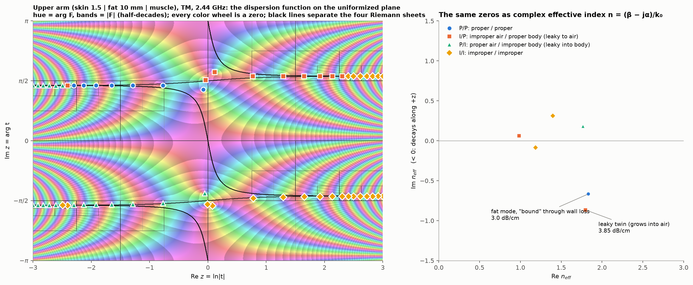
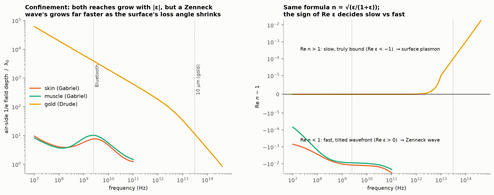
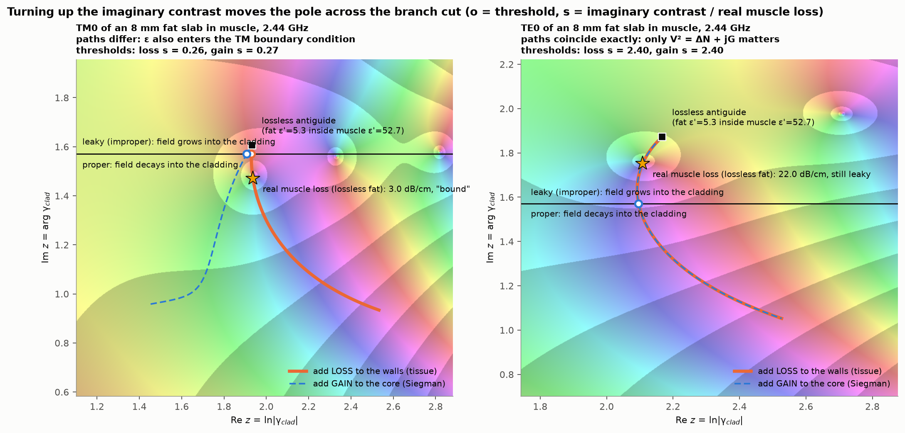
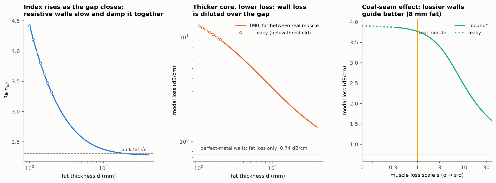
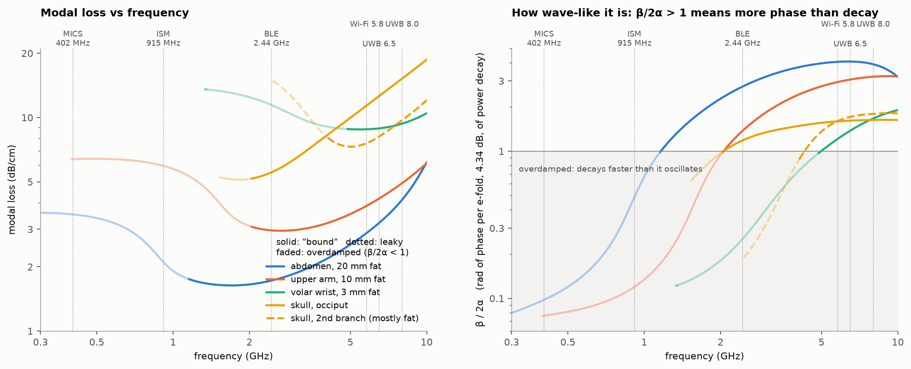
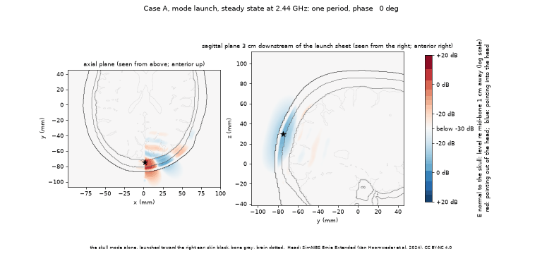

# How can fat guide a radio wave?

> Fat and skull bone have a lower refractive index than the wet tissue around them, so they break the total-internal-reflection rule an optical fiber relies on. They still guide a radio wave: wet, high-permittivity tissue reflects part of a grazing wave at each bounce, and wall loss makes the refracted part die away with depth, so the mode is mathematically "bound" (proper). Leakage drains it within a few centimeters, about as far as any wave gets in wet tissue, in less than one wavelength per e-fold of power.

The solver used here is in this repository's root ([`tissue_slab_modes`](../tissue_slab_modes/)).

Everything here is computed, not measured: the flat-layer modes come from the argument-principle solver in [tissue-slab-modes](../README.md) with tissue permittivities from Gabriel et al. (1996), and [`scripts/modes.py`](scripts/modes.py), [`scripts/residues.py`](scripts/residues.py), [`scripts/make_figures.py`](scripts/make_figures.py) and the [appendix](CATALOG.md) regenerate and document them. Sections 1–2 cover guides and modes in general, sections 3–8 build from familiar guides and a single surface to the body's layered guides, and section 9 checks the head modes in 3D.

## 1. What a waveguide needs

A waveguide stops a wave from spreading sideways, in one of two classic ways.

**Walls that reflect.** A microwave oven feeds its 2.45 GHz power through a short rectangular metal pipe (Vollmer 2004). Metal reflects almost all of the wave, but a closed pipe must exceed half a wavelength across (6.1 cm in air at 2.45 GHz) and carries nothing below that *cutoff*. Two parallel metal plates have *no* thickness cutoff.

**A slower core.** An optical fiber's glass core has a slightly higher *refractive index* than the glass around it, so light travels more slowly in the core. Light meeting the boundary at a grazing angle is totally reflected, and outside the core the field is *evanescent*: it dies away exponentially and carries no power off.

A transverse field pattern that keeps its shape as it travels is a **mode**, varying along the guide as exp(−jβz − αz) with phase constant β and field attenuation rate α. A mode whose field dies away evanescently on both sides of the guide is **bound**.

At radio frequencies a tissue's response to an electric field is its complex relative permittivity ε = ε′ − jε″; with fields varying as exp(j(ωt − βz)), ε″ > 0 is loss from water relaxation and ionic conductivity, and the refractive index is Re √ε ≈ √ε′. At 2.44 GHz fat's index is about 2.3 (ε′ ≈ 5.3), skin's 6.2 (ε′ ≈ 38) and muscle's 7.3 (ε′ ≈ 53). Fat is the *fast* layer, the opposite of a fiber core (an *antiguide*, in optics), so total internal reflection into wet tissue is impossible; the seven- to tenfold permittivity jump only partly reflects a grazing wave (Figure 1b).

## 2. Modes, poles and branch cuts

We model the body as flat layers, with x across them and the wave traveling along z. Modes split into two polarizations: **TM** (transverse magnetic), with H_y parallel to the layers and the main electric field E_x normal to them, and **TE** (transverse electric), with E_y parallel to the layers. Because the normal flux εE_x is continuous across a boundary, a TM wave concentrates its electric field and power in a low-ε layer such as fat or bone. A mode's complex **effective index** is n = (β − jα)/k₀, with free-space wavenumber k₀ = 2π/λ₀: Re n sets the phase speed c/Re n, and Im n < 0 the field decay α = −k₀ Im n, quoted as power loss 8.686 α = −8.686 k₀ Im n in dB/cm.

### The dispersion equation

In each layer j the transverse field is a pair of exponentials, exp(±γⱼk₀x), with γⱼ = √(n² − εⱼ). Requiring H_y and (1/ε) ∂H_y/∂x (TM), or E_y and ∂E_y/∂x (TE), to be continuous at every interface, with one exponential in each outer half-space, leaves one equation F(n) = 0; F is the stack's **dispersion function**. Between two half-spaces ε_t (top) and ε_b (bottom), the TM condition reads

$$\frac{\gamma_t}{\varepsilon_t}+\frac{\gamma_b}{\varepsilon_b}=0\quad\Longrightarrow\quad n^2=\frac{\varepsilon_t\,\varepsilon_b}{\varepsilon_t+\varepsilon_b},$$

the plasmon and Zenneck formula of section 4. For a symmetric slab, a core ε_c of thickness d between walls ε_w, the even TM mode obeys

$$\frac{\kappa}{\varepsilon_c}\tan\left(\frac{\kappa k_0 d}{2}\right)=\frac{\gamma_w}{\varepsilon_w},\qquad \kappa=\sqrt{\varepsilon_c-n^2},\quad \gamma_w=\sqrt{n^2-\varepsilon_w}.$$

Figure 1 plots its exact solution, cos(κk₀x) in the core and cos(κk₀d/2) exp(−γ_w k₀(|x| − d/2)) in the walls, with rays at the angles these wavenumbers imply, from the guide axis: arctan(Re κ / Re n) in the core and arctan(Im γ_w / Re n) in the wall (71° in b, 19° from the normal). For a full stack such as air | skin | fat | muscle, [the appendix](CATALOG.md#the-equations-we-solve) writes out the general F, and Chew (1990, ch. 2) derives it.


**Figure 1.** Three symmetric 8 mm slabs at 2.44 GHz: (a) muscle core between fat walls; (b) fat core between muscle walls; (c) as (b), with lossless walls. Each shows rays (left; refracted rays orange, faded by their power) and the transverse field H_y(x) of its even TM mode (right; solid, one instant; dashed, envelope). Footers give n, the loss and γ_w.

### Riemann sheets and mode types

In an outer half-space the field varies with distance |x| from the stack as exp(−γk₀|x|), and the sign of the root γ is a choice: the field dies away (**proper**, P, Re γ > 0) or grows (**improper**, I, Re γ < 0). Only γ_t and γ_b are double-valued, because inner layers enter F only through even functions of their γⱼ, so F is defined on exactly four **Riemann sheets**. We write the top (air) side's letter first: P/P is bound in the textbook sense, I/P leaks into the air, and P/I into the body.

With lossy materials, proper does not imply total internal reflection, so we also note whether each outer field is evanescent, Re(n² − ε) > 0, or a damped wave crossing the boundary, Re(n² − ε) < 0. Figure 1 shows three cases. In the fiber-like slab (a) the walls hold only an evanescent tail: the mode is truly bound. In fat between wet muscle (b) each grazing bounce reflects part of the wave and refracts the rest steeply into the wall, where absorption makes the field die away with depth (Re γ_w > 0; refraction angles in the [appendix](CATALOG.md)). That mode is proper only because the walls are lossy, which we mark by writing "bound" in quotes, or "bound" through wall loss. With lossless walls (c) the refracted field grows with depth (Re γ_w < 0) and the mode is leaky, yet it loses almost the same power, 3.91 against 3.77 dB/cm: wall loss sets the label, but most of the loss is leakage into the walls either way.

| type | what holds it | in this post |
|---|---|---|
| truly bound | evanescent on both sides (Re(n² − ε) > 0): an index step, as in a fiber | muscle in a limb, between fat and bone; CSF at 7.99 GHz |
| "bound" through wall loss | proper (P/P) only because a lossy outer region absorbs the refracted wave | the fat and skull modes (partial grazing reflection from high-ε walls); the temporalis mode over thicker bone (index step with tunneling); the Zenneck wave on skin (single interface) |
| leaky | improper (Re γ < 0): the field grows with depth because deeper rays left the guide further upstream where the mode was stronger | the temporalis mode over thin bone (< 1.64 mm) |
| surface plasmon | a single interface with Re ε < −1; truly bound | gold, not tissue |
| branch-cut wave | not a mode: the continuous-spectrum part of a source's field that no pole describes | the Norton ground wave over skin; the lateral wave in tissue |

### Which poles a source excites

A small source's exact field is an integral over all real n of the stack's response, which has F(n) in its denominator: H_y(x, z) ∝ ∫ N(x, n) exp(−jk₀nz) / F(n) dn, so each mode is a **pole** of that response. Deforming the path around the two *branch cuts*, which start at the branch points n = √ε of air and of the deepest tissue, splits the field into residues of the swept poles plus two *branch-cut waves*: the space wave plus Norton ground wave in air, and a lateral wave in the body. Tamir & Oliner (1963) gave the rule for which poles are swept (captured): in each half-space the pole must lie on the sheet the deformed contour reaches, and it must decay along z (Im n < 0). [The appendix](CATALOG.md) has the numerical check for our three stacks.

A zero of F can thus be absent from every field. Beside the upper arm's P/P fat mode (n = 1.832 − 0.667j, 3.0 dB/cm) sits an I/P twin (n = 1.797 − 0.866j, 3.85 dB/cm), almost the same in the fat but growing into the air (Figure 2). Slower than light (Re n = 1.80 > 1), the twin cannot radiate into lossless air; it lies outside the air branch-cut region, so no source excites it.



**Figure 2.** Zeros of the upper arm's TM dispersion function (skin 1.5 mm | fat 10 mm | muscle) at 2.44 GHz. Left: F on the plane z = ln t, where t is the uniformizing variable that makes F single-valued ([the appendix](CATALOG.md#the-equations-we-solve) defines it); this unfolds the four Riemann sheets onto one rectangle, black curves separate the sheets, color wheels mark zeros, and marker shapes give their sheets. Right: the same zeros as effective index n.

A captured mode is still one term among several. [`results/residues.md`](results/residues.md) evaluates each mode's residue for a small electric line source at 2.44 GHz, inside the guiding layer or 1 mm above the skin. A current inside the layer and *normal* to it couples best: on the upper arm the fat mode then carries −1.3 dB (86 %) of the exact surface field |H_y| at 2 cm. Raised 1 mm above the skin, the source couples only 3.6 dB less but drives the air-side branch-cut (Norton and space) waves much harder, so the mode's *share* of the field collapses (all sites in the [appendix](CATALOG.md)). Because a mode decays exponentially with distance and the air-side branch-cut integral only algebraically, the branch-cut wave always dominates far enough away.

### How far a mode travels

The ratio β/(2α) = Re n / |2 Im n| counts the **radians of phase gained per e-fold (4.34 dB) of power decay** (the oscillation Q-factor), so a mode travels (β/2α)/2π guide wavelengths while its power falls to 1/e: less than one for every captured tissue mode here, from 0.04 on the wrist to 0.63 in the limb. Wet tissue limits every wave this way; at 2.44 GHz even an unguided plane wave travels only 0.4–0.7 wavelengths per e-fold (fat, at 1.1, is the exception). The layers add confinement: the field spreads only sideways, so its power thins roughly as 1/r instead of 1/r², and for fat 8 mm or thicker the mode also loses less than the surrounding wet tissue. "Guided" here therefore means confined and steered over a few centimeters, not carried far.

| mode | loss (dB/cm) | wavelengths per e-fold | bulk loss of core; walls (dB/cm) |
|---|---|---|---|
| limb muscle, truly bound (TE) | 4.0 | 0.63 | muscle 3.9 (0.67 wavelengths per e-fold) |
| CSF, truly bound, 7.99 GHz | 22.9 | 0.34 | CSF 24.7 (0.36) |
| fat, upper arm, "bound" | 3.0 | 0.22 | fat 0.74; skin and muscle 3.8–3.9 |
| fat, abdomen (20 mm), "bound" | 1.7 | 0.44 | fat 0.74; skin and muscle 3.8–3.9 |
| skull, occiput, "bound" | 5.5 | 0.19 | bone 1.9–3.0; fat 0.74 above; dura, CSF and gray matter 4.2–6.8 below |
| temporalis over 1.5 mm of bone, leaky | 5.9 | 0.31 | muscle 3.9; fat 0.74 above, bone 1.9 below |

## 3. Guides we already live with

Index guiding, lossy reflecting walls and branch-cut waves all have familiar examples. In the eye, Müller cells span the retina with a higher refractive index than the surrounding tissue and pipe light to the photoreceptors (Franze et al. 2007). Very-low-frequency radio (3–30 kHz) travels around the world between the ground and the lower ionosphere (Wait 1957); neither wall is a perfect metal, but both reflect far more than they absorb. Medium-wave AM stations are heard over flat ground via the Norton ground wave (Norton 1936, 1937), a branch-cut wave, not a mode; skin carries the same kind of wave.

## 4. Waves that hug a surface

A single interface can guide too. With air above (ε_t = 1), the formula of section 2 becomes n = √(ε/(1 + ε)). On gold at optical frequencies, where Re ε < −1, it gives the **surface plasmon**: slower than light (Re n > 1), pressed against the metal at visible wavelengths, and truly bound. On a lossy material with Re ε > 0 it gives the **Zenneck wave** (Michalski & Mosig 2022), whose phase speed along the surface exceeds c (Re n < 1) because its wavefront tilts into the material. Only the material's absorption of what flows into it makes the field fall off away from the surface, so the wave is "bound" through wall loss.

On skin at 2.44 GHz the Zenneck wave reaches far into the air (Figure 3). Over a plain skin half-space (n = 0.988 − 0.003j, 0.01 dB/cm) its field falls to 1/e about 93 cm above the surface, 7.6 free-space wavelengths, with 99.9 % of its power in the air; a gold plasmon at 10 µm reaches a comparable 11.5 wavelengths. Over the layered temple (n = 0.973 − 0.023j, 0.10 dB/cm) it reaches about 22 cm (1.8 wavelengths).



**Figure 3.** Surface plasmon and Zenneck wave from one formula. Left: 1/e field depth in air, in free-space wavelengths λ₀, for skin and muscle (Gabriel model) and gold (Drude model); both grow with |ε|, a Zenneck wave's far faster as the loss angle shrinks. Right: Re n − 1, positive (slow) for gold, where Re ε < −1, and negative (fast) for tissue.

The Zenneck wave has the lowest attenuation of any mode here, yet a small antenna on or near the skin does not launch it: on the temple stack its P/P pole is hidden under the air branch cut and drops out of the field ([appendix](CATALOG.md)). A large, profile-matched aperture launches a Zenneck-like field, but only near the aperture (Hill & Wait 1980). For a source above the skin much of the surface field is the Norton ground wave plus the space wave, the classic resolution of a century-old argument over Zenneck's wave (Collin 2004; Michalski & Mosig 2016), though the fat mode can carry a large share (54 % at 2 cm for a tangential current 1 mm above the arm). Grimm & Manteuffel (2014) model on-body links with Norton surface waves.

## 5. Guides that break the rule

Fat and bone are low-index cores between high-permittivity walls, like the slab of Figure 1b. **Grazing reflection from high-permittivity walls** holds a wave in them for a while: wet tissue (ε′ ≈ 38–66) around fat (ε′ ≈ 5.3) or bone (ε′ ≈ 11–19) partly reflects a TM wave at grazing incidence. In the 8 mm fat slab of Figure 1 each bounce sends back about a third of the power, and 72 % of the mode's power flows in the fat, a little like a very leaky parallel-plate guide. Without wall loss (Figure 1c) the mode is *leaky* (improper, P/I or I/I); making it proper takes a non-Hermitian contrast, gain in the core or loss in the walls, to pull the pole across the branch cut.

**Gain in the core.** Siegman (2003, 2007) showed that a fiber whose core has a *lower* index than its lossless cladding becomes a proper guide if the core amplifies strongly enough: the gain replenishes the power lost to refraction, so the outgoing wave in the cladding decays with depth instead of growing.

**Loss in the walls.** Wall absorption is the Riemann-sheet mirror of Siegman's gain guiding, exact for TE and nearly so for TM. It damps the refracted wave as it travels into the wall; once that damping outpaces the mode's decay along the guide, the field decays with depth on both sides (Re γ > 0) and the pole crosses the branch cut from leaky (improper) to **"bound" (proper, P/P)**. Still higher wall conductivity lowers the wall impedance and adds conductive reflection, keeping more field out of the walls and *lowering* the modal loss toward the metal-plate limit: the **coal-seam effect**, described in 1970s–80s mining radio for low-loss coal between conductive rock walls (Emslie & Lagace 1976; Wait 1976; Hill 1984).

We take the term **"loss-guided"** from Nagel, Blair & Scarpulla (2011), who took it from Siegman (2003) and use it for the reverse geometry: modes that a thin absorbing film, the core, has only because it is lossy between lossless claddings. In fat and bone both the guiding reflection and the sheet-flipping loss come from the wet walls, so we call the tissue regime **lossy-wall loss guiding** (or **"bound" through wall loss**).

## 6. The body as a layered stack

Water sets both the index and the loss of a tissue: wet tissues have a high index and absorb strongly, while fat and bone hold little water (Gabriel et al. 1996).

| tissue | ε at 2.44 GHz | index Re √ε | wavelength (cm) | plane-wave loss (dB/cm) |
|---|---|---|---|---|
| air | 1 | 1.0 | 12.3 | 0 |
| fat | 5.3 − 0.8j | 2.3 | 5.3 | 0.74 |
| cortical bone | 11.4 − 2.9j | 3.4 | 3.6 | 1.89 |
| cancellous bone | 18.6 − 5.9j | 4.4 | 2.8 | 3.01 |
| skin | 38.0 − 10.7j | 6.2 | 2.0 | 3.83 |
| dura | 42.0 − 12.2j | 6.6 | 1.9 | 4.15 |
| tendon | 43.1 − 12.4j | 6.6 | 1.9 | 4.14 |
| muscle | 52.7 − 12.8j | 7.3 | 1.7 | 3.87 |
| gray matter | 48.9 − 13.3j | 7.1 | 1.7 | 4.17 |
| CSF | 66.3 − 25.4j | 8.3 | 1.5 | 6.81 |

Our five standard flat stacks run from air down into the deepest tissue half-space:
- **Upper arm:** skin 1.5 mm | fat 10 mm | muscle.
- **Abdomen:** skin 2.0 mm | fat 20 mm | muscle.
- **Volar wrist:** skin 1.3 mm | fat 3.0 mm | tendon 3.0 mm | muscle.
- **Back of the head (occiput):** skin 2.0 mm | fat 3.0 mm | 8.4 mm of three-layer skull bone (1.5 mm outer cortical table | 5.6 mm cancellous diploë | 1.3 mm inner cortical table) | dura 0.5 mm | CSF 2.0 mm | gray matter.
- **Temple:** skin 1.5 mm | fat 2.0 mm | temporalis muscle 8.1 mm (Pirri et al. 2021) | cortical temporal squama 1.5 mm (measured 1.52 ± 0.50 mm in 72 adults, Bhushal et al. 2025) | dura 0.5 mm | CSF 2.0 mm | gray matter.

In the first four stacks the low-index fat or bone layer sits between wet, high-index tissues, an antiguide by the fiber rule; at the temple the high-index temporalis muscle is itself the core (section 8).

## 7. Layers versus wavelength

At 2.44 GHz our 0.5–25 mm tissue layers are a few hundredths of a wavelength to about one and a half wavelengths across: thin-film territory, where a ray picture can illustrate a mode (Figure 1) but only the wave equations of section 2 can compute it.

Tubular body parts are the nearest analogs of the oven's closed pipe. Treating the wet tissue around a core as a perfectly conducting cylinder (lowest mode TE₁₁, [`results/modes.md`](results/modes.md)), a femur shaft cuts off at 2.0–3.0 GHz, a tibia at 2.5–3.8 GHz, the trachea at 7.0–13.5 GHz (adult male coronal diameter 13–25 mm, Lawrence et al. 2014) and the ear canal at 22–29 GHz. In these first-order screens with assumed bone and canal geometries, the femur shaft sits right at cutoff at Bluetooth (2.44 GHz), and the trachea and ear canal are far too narrow to carry a pipe mode there. A flat layer has no cutoff for TM₀, though thin fat turns that mode leaky (Figure 6); the body's guides are its layers.

## 8. The body's guides, type by type

Figure 4 shows five of the body's guides, each launched by its own transverse field profile.


**Figure 4.** Each row: permittivity (left), transverse profile |H_y| or |E_y| (middle), and instantaneous field against height and distance at 2.44 GHz (right) over 10 cm, or four guide wavelengths (50 cm) for the Zenneck wave; color depth is the field level on a log scale down to 40 dB below its launch-plane peak, red and blue opposite signs. The limb-muscle mode runs cleanly inside the muscle; the "bound" fat and skull modes shed tilted waves into the wet tissue below; through 1.5 mm of bone the temporalis mode leaks into the brain, its amplitude growing only 0.2 dB/cm with depth, the mark of a leaky P/I mode (in a real field such a tail appears only downstream of the source); and the Zenneck wave's crests lean forward because its phase travels 14° down into the skin. Still image: [`launch_maps.png`](figures/modes/launch_maps.png); one GIF per mode: [`figures/modes/`](figures/modes/).

### Truly bound: muscle in a limb

Muscle between fat and bone guides by total internal reflection, as a fiber does. In an assumed limb stack (air | skin 1.5 mm | fat 10 mm | muscle 25 mm | cortical bone 6 mm | yellow marrow, ε ≈ 5.3 − 0.7j, index 2.3), the fundamental TE mode at 2.44 GHz has n = 7.04 − 0.89j, keeps 98 % of its power in the muscle and loses 4.0 dB/cm ([appendix](CATALOG.md)). None of our five standard stacks has a truly bound mode at or below 6.5 GHz: their deepest half-space is high-index muscle or brain, and the 2 mm CSF layer is too thin to overcome its asymmetric-slab cutoff until about 6.65 GHz at the temple and 6.9 GHz at the occiput. At 7.99 GHz the occipital CSF carries a truly bound TE mode (n = 6.66 − 1.58j, 47 % of power in CSF and 46 % in gray matter) that loses 22.9 dB/cm. Carried by a high-index, and therefore wet, layer, a truly bound mode loses roughly what that tissue absorbs in bulk (table in section 2).

### "Bound" through wall loss: the fat mode

On the upper-arm stack (skin 1.5 mm | fat 10 mm | muscle), the TM fat mode has n = 1.832 − 0.667j, 82 % of its power in the fat and 3.0 dB/cm of loss. Through the thin skin, total internal reflection holds its top side against the air (Re(n² − 1) = 1.91, evanescent); the fat is an antiguide only toward the muscle, and only that side's "bound" label comes from wall loss.

Figure 5 isolates the sheet crossing in a symmetric 8 mm slab of *lossless* fat (ε = 5.3) between muscle half-spaces (ε′ = 52.7), where the mode starts leaky. Wall loss, or core gain as in Siegman (2003, 2007), of s times real muscle loss moves the TM pole onto the proper (P/P) sheet at s = 0.26 (loss) or 0.27 (gain); the wall-loss path reaches **3.0 dB/cm** (n = 2.458 − 0.672j) at s = 1. For TE the two paths coincide exactly, since only Siegman's normalized contrast V² = ΔN + jG enters (defined in the [appendix](CATALOG.md)), and need s = 2.40: 8 mm is too thin for TE, whose field must nearly vanish at each high-permittivity wall, as between metal plates. In this slab TE₀ turns "bound" at real muscle loss only above about 13 mm of fat; the 20 mm abdomen carries a TE mode held from above by skin and air (2.1 dB/cm against 1.7 for TM).



**Figure 5.** Pole paths for the lossless-fat slab, TM₀ (left) and TE₀ (right), on the uniformized z = ln γ_clad plane (γ_clad: the cladding-side decay constant); the horizontal black line separates leaky (above) from proper (Re γ_clad > 0, below). Solid: wall loss; dashed: core gain; both scaled by s relative to real muscle loss (|ε″| = 12.8). Squares: lossless antiguide; circles: branch-cut crossing; stars: real muscle loss (s = 1).

Figure 6 restores fat's own 0.74 dB/cm loss (ε = 5.3 − 0.8j) in the same geometry; its points at s = 0 and s = 1 are the slabs of Figure 1c and 1b. The pole crosses the branch cut at s = 0.32 and reaches n = 2.420 − 0.848j at s = 1; higher wall conductivity lowers the loss further, toward the perfect-metal limit of fat's own 0.74 dB/cm, the coal-seam effect (full sweep in the [appendix](CATALOG.md)).

Thinner fat slows the mode but makes it lossier: as the gap closes from 25 mm to 1 mm (Figure 6, left and middle), Re n rises from 2.29 to 4.42 and the loss to 12.8 dB/cm, since close, resistive walls slow and damp the wave together, as in a lossy parallel-plate line. Below about 2 mm the mode turns leaky.



**Figure 6.** Symmetric slab of lossy fat (ε = 5.3 − 0.8j) between muscle half-spaces, 2.44 GHz, TM₀. Left and middle: effective index and modal loss against fat thickness d (open circles: leaky). Right: modal loss of the 8 mm slab against muscle-loss scale s, dotted while leaky; the vertical line marks real muscle (s = 1). Dashed: perfect-metal walls (0.74 dB/cm).

Each fat mode has a frequency of lowest loss (Figure 7), and a mode whose β/(2α) falls below 1 is overdamped. At 2.44 GHz the abdomen (20 mm fat) loses 1.72 dB/cm (β/2α = 2.74), close to its minimum of about 1.6 dB/cm near 1.7 GHz; the upper arm (10 mm) loses 3.0 dB/cm (β/2α = 1.37); and the volar wrist (3 mm) loses 11.5 dB/cm and is overdamped (β/2α = 0.25). The three turn wave-like (β/2α > 1) above about 1.2, 2.0 and 5.0 GHz, each 0.5–0.6 GHz below its loss minimum.



**Figure 7.** Modal loss (left) and β/(2α) (right) against frequency for the TM fat modes of the abdomen (20 mm), upper arm (10 mm) and volar wrist (3 mm), and for the occipital TM skull mode and its second, fat-dominated branch (dashed). Curves are faded where overdamped (β/2α < 1) and dotted where leaky; vertical dotted lines mark medical and wireless bands.

### "Bound" through wall loss: the occipital skull

The same mechanism works in cranial bone. At the back of the head, 8.4 mm of three-layer bone (index 3.4–4.4) under 3 mm of fat (2.3) forms a low-index layer between the scalp (6.2) and dura/CSF/brain (6.6–8.3). Its fundamental TM mode at 2.44 GHz is "bound" (P/P, n = 2.949 − 1.246j), keeps 46 % of its power in the bone (33 % in gray matter, 17 % in fat) and loses 5.5 dB/cm. With β/(2α) = 1.2 it is only just wave-like (Figure 7); unlike the fat modes, it reaches its lowest loss, near 1.8 GHz, while still overdamped, turning wave-like only above about 2 GHz. A second "bound" TM branch, carried mostly by the overlying fat, loses less above 4.0 GHz ([appendix](CATALOG.md)).

### Index guiding with a leak: the temporalis muscle

At the temple the mode's |H_y| peaks in the temporalis muscle (index 7.3), the high-index layer between subcutaneous fat (2.3) and the temporal bone (3.4): ordinary index guiding in a lossy core, though over 6 mm of bone the bone still carries 36 % of the power. The thin squama below is only a low-index barrier: CSF and gray matter have higher indices (8.3 and 7.1) than the mode (Re n ≈ 4.5–5.2), so the wave tunnels across the bone (frustrated total internal reflection) into the brain. Loss and index change smoothly with bone thickness; only the label changes, at **1.64 mm**. Above it the mode is proper (P/P), losing 4.3 dB/cm at 6 mm of bone (n = 4.49 − 0.97j); below it the mode is leaky, losing 5.9 dB/cm along the guide while its field grows 0.20 dB/cm with depth into the brain at 1.5 mm (n = 5.15 − 1.33j). Measured adult squama thickness, 1.52 ± 0.50 mm (Bhushal et al. 2025), straddles this threshold (Figure 8).


**Figure 8.** The temple stack of section 6 with variable bone thickness, 2.44 GHz, TM. Left and middle: modal loss and Re n_eff against bone thickness, smooth through the change from "bound" (P/P, dots) to leaky (P/I, triangles); shading marks the measured squama thickness (mean ± one standard deviation). Right: |H_y| over 4.0 mm (P/P, 4.6 dB/cm) and 1.5 mm (P/I, 5.9 dB/cm) of bone.

### The reverse geometry: a lossy core

Nagel, Blair & Scarpulla's (2011) reverse geometry, a lossy core between lossless walls, appears in tissue only in idealized form. At 7.99 GHz a lossy muscle core in *lossless* fat carries coupled Zenneck-type waves on its faces that, like their loss-guided modes, are proper only because the core is lossy (fat's real loss turns them improper); at 2.44 GHz a fat core between lossless muscle would need 3.7–7 times its real loss (TM) to carry such a root ([appendix](CATALOG.md)).

## 9. In a real head

A real head curves, its bone thickens and thins, and venous sinuses or CSF pockets lie under the inner table. We tested the head modes with 3D full-wave FDTD simulations (MEEP) on the SimNIBS Ernie Extended head, segmented from MRI and CT (Van Hoornweder et al. 2024), with lossy Gabriel tissues on a 0.5/0.25 mm grid (anatomy at 0.5 mm) at 2.44/7.99 GHz ([`scripts/head_3d.py`](scripts/head_3d.py)). In mode-launch cases a Huygens sheet excites the 1D mode profile alone; summary numbers and decay fits are in [`results/case_*/`](results/).

**Occipital skull mode.** Launched at the back of the head toward the right ear (`case_a_mode`), the wave stays guided along the curving skull (Figure 9) and decays at about the flat-model rate: with Gaussian beam spreading removed, the mid-bone field loses **3.2–3.7 dB/cm**, 16–28 % below the launch site's 4.4 dB/cm 1D prediction. Uncorrected, it falls at 4.2 dB/cm over 1–6 cm, matching that rate, so there the gap mostly reflects the assumed spreading correction. [The appendix](CATALOG.md) has the local stack, sinus check, point-dipole cross-check and phase-index trend.

**Temporalis mode.** At the thinnest spot of each temporal squama (`case_c_left`, `case_c_right`), Ernie's temporalis muscle is 4.05 mm thick over 2.05 mm of bone on the left (1D mode: n = 3.55 − 1.68j, 7.4 dB/cm, 83 % of power in the brain) and 5.05 mm over 3.0 mm of bone on the right (1D mode: n = 3.84 − 1.35j, 6.0 dB/cm, 63 %). On these local stacks the 1D mode turns leaky below 1.70–1.75 mm of bone (left) and 1.95–2.00 mm (right), so both launch spots are on the "bound" side. The left margin, 0.3–0.35 mm ([the appendix](CATALOG.md) has the voxel-measured thickness), is below the 0.5 mm grid, and with Re(n² − ε_bone) ≈ −1.6 the left bone is not even an evanescent barrier, so the 3D run can neither confirm nor refute that side's flat-layer "bound" label. In 3D the left bone stays at 1.9–2.5 mm for about 1.4 cm before passing 3 mm, the right thickens from 3.0 to 3.4–4 mm within about 1 cm, and the thinner left temple sheds more wave into the brain than the right ([`results/case_c_left/`](results/case_c_left/), [`results/case_c_right/`](results/case_c_right/): thickness profiles and interval-by-interval decay).

**Head modes at 7.99 GHz.** Both are short-lived. The skull case (`case_d_skull`) launches the bone-dominated branch, which sheds much less into the brain than at 2.44 GHz; with spreading removed it loses **10.5–11.3 dB/cm** over 1–6 cm (1D: 13.7 dB/cm) and falls **24 dB between 1 and 3 cm**. A TM CSF mode (`case_d_csf`), launched at Ernie's thickest occipital CSF pocket, decays faster still: beyond about 1.5 cm the wave has left the small pocket, and it loses **19.0–20.2 dB/cm** (1D: 25.3 dB/cm) and falls **43 dB between 1 and 3 cm**.

**Around the head from an external dipole.** From a point dipole 3 mm outside the skin behind and above the left ear (`case_b`), the field creeping around the back of the head reaches the mirror point behind the right ear, about 17 cm away along the head, only 42.1 dB below its level 1 cm from the source. Just inside the skin, with cylindrical spreading removed, it decays at only about 1–2 dB/cm, slower than any head tissue mode computed here (about 3.2 dB/cm or more): the air outside feeds that field rather than the skin guiding it.



**Figure 9.** The occipital skull mode (`case_a_mode`) in Ernie's head at 2.44 GHz: crests run along the bone and fade. Steady-state radial E (roughly normal to the skull) over one period, log scale from +20 to −30 dB re mid-bone 1 cm from the source (red pointing out of the head, blue into it), in the axial plane through the source (left) and the sagittal plane 3 cm downstream (right). Decay curves, field-strength maps and the phase-velocity check: [`case_a_mode_res2.png`](results/case_a_mode/case_a_mode_res2.png). Head: SimNIBS Ernie Extended (Van Hoornweder et al. 2024), CC BY-NC 4.0; this figure carries the same license.

## 10. Uses and patents

The subcutaneous fat channel is already in use: the Uppsala *Fat-IBC* group models and measures fat between skin and muscle as a low-loss microwave dielectric waveguide for intra-body communication (Asan et al. 2017, 2018), reaching 92 Mb/s with low-cost WLAN hardware (Rangaiah et al. 2024) and 120 Mb/s since (Engstrand et al. 2025; Engstrand 2026). Hearing aids rely on radio waves creeping around the head in the air outside the skin (Kvist, Thaysen & Jakobsen 2015; patents by GN ReSound and Starkey; sections 4 and 9), and RF links through the skull are being studied directly (Särestöniemi et al. 2022). [The appendix](CATALOG.md) lists related patents by mode.

Beyond Fat-IBC's own result, two parts of the modal picture here appear new:
1. **The Riemann-sheet and antiguide taxonomy** of section 5, which ties the fat and skull modes to gain-guided antiguides, coal-seam modes and loss-guided thin films, and separates the grazing reflection from high-permittivity wet walls from the branch-cut role of the wall loss that makes the mode proper (P/P).
2. **Cranial modes in the skull and temple:** the occipital skull-bone mode, "bound" through wall loss, and the index-guided temporalis mode, which tunnels through the thin squama into the brain at every thickness and whose flat-layer label flips at 1.64 mm, close to a measured adult mean thickness.

## What we don't know yet

- **Anatomy.** Our 1D stacks are flat and uniform, whereas real bodies curve and contain vessels, sutures, and fibers, and our 3D simulations test a single anatomical head (SimNIBS Ernie Extended).
- **Launching and link budgets.** Figure 4 and the 3D mode-launch runs excite each mode with an idealized mode-matched profile; for real sources we have only a small line source's share of the surface field in the flat stacks (section 2 and [the appendix](CATALOG.md)).
- **The limb.** The truly bound limb-muscle mode rests on an assumed planar geometry with low-water yellow marrow beneath the cortex.
- **Measurements.** Fat-IBC has measured the fat channel (section 10), but no mode's index or loss here has been measured directly; all values come from Gabriel Cole-Cole models.

## References

- Asan, N. B. et al. (2017). Intra-body microwave communication through adipose tissue. *Healthc. Technol. Lett.* 4(4), 115–121. https://doi.org/10.1049/htl.2016.0104
- Asan, N. B. et al. (2018). Characterization of the fat channel for intra-body communication at R-band frequencies. *Sensors* 18(9), 2752. https://doi.org/10.3390/s18092752
- Bhushal, K. et al. (2025). Thickness of neurocranium bones of deceased adults: a cross-sectional study. *J. Inst. Med. Nepal* 47(3), 84–90. https://doi.org/10.59779/jiomnepal.1447
- Boston University. US 2023/0140692 A1 (2023), Wireless neuromodulation via microwave split ring resonator, https://patents.google.com/patent/US20230140692A1/en
- Chew, W. C. (1990). *Waves and Fields in Inhomogeneous Media.* Van Nostrand Reinhold; IEEE Press reprint. https://doi.org/10.1109/9780470547052
- Cochlear Ltd. US 9,191,759 B2 (2015). Data transmission through a recipient's skull bone. https://patents.google.com/patent/US9191759B2/en
- Collin, R. E. (2004). Hertzian dipole radiating over a lossy earth or sea: some early and late 20th-century controversies. *IEEE Antennas Propag. Mag.* 46(2), 64–79. https://doi.org/10.1109/MAP.2004.1305535
- CPG Technologies. US 9,923,385 B2 (2018), Excitation and use of guided surface waves, https://patents.google.com/patent/US9923385B2/en; US 10,062,944 B2 (2018), Guided surface waveguide probes, https://patents.google.com/patent/US10062944B2/en
- Emslie, A. G. & Lagace, R. L. (1976). Propagation of low and medium frequency radio waves in a coal seam. *Radio Sci.* 11(4), 253–261. https://doi.org/10.1029/RS011i004p00253
- Engstrand, J., Johansson, T., Karlsson, R. & Augustine, R. (2025). 120 Mb/s Fat-Intrabody Communication (Fat-IBC). *Proc. 55th European Microwave Conference.* https://urn.kb.se/resolve?urn=urn:nbn:se:uu:diva-574576
- Engstrand, J. (2026). *Fat-Intrabody Communication for Medical Implants and Brain–Computer Interfaces.* PhD thesis, Uppsala University. https://urn.kb.se/resolve?urn=urn:nbn:se:uu:diva-578214
- Franze, K. et al. (2007). Müller cells are living optical fibers in the vertebrate retina. *PNAS* 104(20), 8287–8292. https://doi.org/10.1073/pnas.0611180104
- Gabriel, S., Lau, R. W. & Gabriel, C. (1996). The dielectric properties of biological tissues: III. Parametric models for the dielectric spectrum of tissues. *Phys. Med. Biol.* 41(11), 2271–2293. https://doi.org/10.1088/0031-9155/41/11/003
- GN ReSound. EP 2 871 861 (filed 2013, granted 2018). A hearing aid with an antenna. https://patents.google.com/patent/EP2871861A1/en
- Grimm, M. & Manteuffel, D. (2014). Norton surface waves in the scope of body area networks. *IEEE Trans. Antennas Propag.* 62(5), 2616–2623. https://doi.org/10.1109/TAP.2014.2307347
- Hill, D. A. (1984). Radio propagation in a coal seam and the inverse problem. *J. Res. Natl. Bur. Stand.* 89(5), 385–394. https://www.nist.gov/publications/radio-propagation-coal-seam-and-inverse-problem-0
- Hill, D. A. & Wait, J. R. (1980). On the excitation of the Zenneck surface wave over the ground at 10 MHz. *Annales des Télécommunications* 35, 179–182. https://doi.org/10.1007/BF03000465
- Kvist, S. H., Thaysen, J. & Jakobsen, K. B. (2015). Ear-to-ear on-body channel model for hearing aid applications. *IEEE Trans. Antennas Propag.* 63(1), 344–352. https://doi.org/10.1109/TAP.2014.2368578
- Lawrence, D. A., Branson, B., Oliva, I. & Rubinowitz, A. (2014). MDCT of the central airways: anatomy and pathology. *Applied Radiology* 43(11), 8–21. https://doi.org/10.37549/AR2129
- Michalski, K. A. & Mosig, J. R. (2016). The Sommerfeld half-space problem revisited: from radio frequencies and Zenneck waves to visible light and Fano modes. *J. Electromagn. Waves Appl.* 30(1), 1–42. https://doi.org/10.1080/09205071.2015.1093964
- Michalski, K. A. & Mosig, J. R. (2022). Sommerfeld pole or Brewster zero? Zenneck wave or surface plasmon? *IEEE Antennas Propag. Mag.* 64(6), 70–80. https://doi.org/10.1109/MAP.2021.3110489
- Nagel, J. R., Blair, S. & Scarpulla, M. A. (2011). Exact field solution to guided wave propagation in lossy thin films. *Opt. Express* 19(21), 20159–20171. https://doi.org/10.1364/OE.19.020159
- Norton, K. A. (1936, 1937). The propagation of radio waves over the surface of the earth and in the upper atmosphere, parts I and II. *Proc. IRE* 24, 1367–1387, https://doi.org/10.1109/JRPROC.1936.227360; 25, 1203–1236, https://doi.org/10.1109/JRPROC.1937.228544
- Oruganti, S. K. et al. (2020). Experimental realization of Zenneck type wave-based non-radiative, non-coupled wireless power transmission. *Sci. Rep.* 10, 925. https://doi.org/10.1038/s41598-020-57554-1
- Pirri, C. et al. (2021). Ultrasound imaging of head/neck muscles and their fasciae: an observational study. *Front. Rehabil. Sci.* 2, 743553. https://doi.org/10.3389/fresc.2021.743553
- Probingon AB. US 12,357,187 B2 (2025), Systems and methods for assessing a physiological property of a biological tissue based on its microwave transmission properties, https://patents.google.com/patent/US12357187B2/en
- Rangaiah, P. K. B. et al. (2024). 92 Mb/s Fat-Intrabody Communication (Fat-IBC) with low-cost WLAN hardware. *IEEE Trans. Biomed. Eng.* 71(1), 89–96. https://doi.org/10.1109/TBME.2023.3292405
- Särestöniemi, M., Pomalaza-Raez, C., Sayrafian, K., Myllylä, T. & Iinatti, J. (2022). A preliminary study of RF propagation for high data rate brain telemetry. In *Body Area Networks. Smart IoT and Big Data for Intelligent Health Management*, 126–138, EAI/Springer LNICST 420. https://doi.org/10.1007/978-3-030-95593-9_11
- Siegman, A. E. (2003). Propagating modes in gain-guided optical fibers. *J. Opt. Soc. Am. A* 20, 1617. https://doi.org/10.1364/JOSAA.20.001617
- Siegman, A. E. (2007). Gain-guided, index-antiguided fiber lasers. *J. Opt. Soc. Am. B* 24, 1677. https://doi.org/10.1364/JOSAB.24.001677
- Starkey Laboratories. US 10,051,388 B2 (2018). Radio frequency antenna for an in-the-ear hearing device. https://patents.google.com/patent/US10051388B2/en
- Tamir, T. & Oliner, A. A. (1963). Guided complex waves. Part 1: Fields at an interface. *Proc. IEE* 110(2), 310–324. https://doi.org/10.1049/piee.1963.0044
- Tesla, N. (1905). Art of transmitting electrical energy through the natural mediums. US 787,412 (filed 1900). https://patents.google.com/patent/US787412A/en
- Van Hoornweder, S. et al. (2024). Head and shoulders—The impact of an extended head model on the simulation and optimization of transcranial electric stimulation. *Imaging Neurosci.* 2. https://doi.org/10.1162/imag_a_00379
- Vollmer, M. (2004). Physics of the microwave oven. *Phys. Educ.* 39(1), 74–81. https://doi.org/10.1088/0031-9120/39/1/006
- Wait, J. R. (1957). The mode theory of VLF ionospheric propagation for finite ground conductivity. *Proc. IRE* 45, 760–767. https://doi.org/10.1109/JRPROC.1957.278469
- Wait, J. R. (1976). Note on the theory of transmission of electromagnetic waves in a coal seam. *Radio Sci.* 11(4), 263–265. https://doi.org/10.1029/RS011i004p00263

## Reproduce

Run from `explainer/`:

```
conda activate tsm                         # MEEP 1.35, numpy, scipy, mpmath
pip install -e ..                          # the tissue_slab_modes solver at the repository root (or `pip install -e .` from the root)
python scripts/make_figures.py             # README figures 1-3, 5-8 and CATALOG figure 10 (files 00-07)
python scripts/modes.py                    # every flat-layer mode: results/modes.md, figures/modes/ (stills and GIFs, incl. figure 4)
python scripts/residues.py                 # results/residues.md
```

`python scripts/modes.py --no-scan` skips the slowest check. The head data check needs the head models (downloaded once, git-ignored):

```
uv run --with nibabel --with numpy --with scipy --with matplotlib python head_data_check/head_data_check.py
```

The 3D head runs ([`scripts/head_3d.py`](scripts/head_3d.py)) need MPI and the solver's [`meep/common.py`](../meep/common.py), which is at the repository root, so no separate checkout is needed; the commands for every case, their timings, and the macOS/Linux libfabric setup are in [the appendix](CATALOG.md).

## Data and licenses

This repository is educational and non-commercial. The code is MIT ([`LICENSE`](../LICENSE)). Tissue permittivities follow Gabriel et al. (1996). The head data check and the 3D runs use the **SimNIBS Ernie Extended** head model (Van Hoornweder et al. 2024), licensed [CC BY-NC 4.0](https://creativecommons.org/licenses/by-nc/4.0/); figures and videos derived from it, including Figure 9 and everything in `results/case_*`, carry that license. The head data check also compares the New York Head. No head data is redistributed here; the scripts download it from the original sources. Per-dataset terms are in [`head_data_check/README.md`](head_data_check/README.md).
