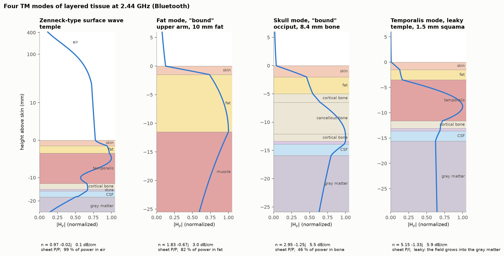

# How can fat guide a radio wave?

> Fat should be a poor waveguide: unlike an optical-fiber core, it has a lower refractive index than the wet tissue around it. Yet our calculations show a radio wave remaining concentrated in fat for a few centimeters. Wet tissue partly reflects a grazing wave, while absorption kills what escapes.

Everything here is computed, not measured. The flat-layer results come from the argument-principle solver in [tissue-slab-modes](../README.md), using tissue permittivities from Gabriel et al. (1996); the curved-head checks are full-wave simulations of one anatomical model.

**"Guided" here means confined and steered over a few centimeters, not carried far.** The fields lose most of their power in less than one guide wavelength, much as any radio wave does in wet tissue.

## 1. What a waveguide needs

A waveguide stops a wave from spreading sideways. Two familiar mechanisms do the job.

**Walls that reflect.** A microwave oven feeds its 2.45 GHz power through a short rectangular metal pipe (Vollmer 2004). Metal reflects almost all of the wave, but a closed pipe must exceed half a wavelength across—6.1 cm in air at 2.45 GHz—and carries nothing below that *cutoff*. Two parallel metal plates have no thickness cutoff.

**A slower core.** An optical fiber's glass core has a slightly higher *refractive index* than the glass around it, so light travels more slowly in the core. Light meeting the boundary at a grazing angle is totally reflected. The field outside is *evanescent*: it dies away exponentially and carries no power off.

A transverse field pattern that keeps its shape as it travels is a **mode**. We write its variation along the guide as exp(−jβz − αz), where β is the phase constant and α is the field attenuation rate. A mode whose field dies away evanescently on both sides is **bound**.

At radio frequencies, a tissue's response to an electric field is its complex relative permittivity ε = ε′ − jε″. With fields varying as exp(j(ωt − βz)), ε″ > 0 represents loss from water relaxation and ionic conductivity, while the refractive index is approximately Re √ε. At 2.44 GHz fat's index is about 2.3, compared with 6.2 for skin and 7.3 for muscle. Fat is the *fast* layer, the opposite of a fiber core—an *antiguide*, in optics—so total internal reflection into wet tissue is impossible.


**Figure 1.** Three symmetric 8 mm slabs at 2.44 GHz: (a) muscle core between fat walls; (b) fat core between muscle walls; (c) as (b), with lossless walls. Each panel pairs a ray picture with the transverse field $H_y(x)$ of its even TM mode. The footers give the effective index $n$, loss, and wall decay constant $\gamma_w$.

For the symmetric slab in Figure 1, a core of permittivity $\varepsilon_c$ and thickness $d$ between walls $\varepsilon_w$ has the even TM condition

$$\frac{\kappa}{\varepsilon_c}\tan\left(\frac{\kappa k_0 d}{2}\right)=\frac{\gamma_w}{\varepsilon_w},\qquad \kappa=\sqrt{\varepsilon_c-n^2},\quad \gamma_w=\sqrt{n^2-\varepsilon_w}.$$

This one equation produces all three panels; the [appendix](CATALOG.md#the-equations-we-solve) derives the multilayer form and explains its sheets.

## 2. Grazing reflection holds the wave for a while

Fat and bone are low-index cores between high-permittivity walls, like Figure 1b. **Grazing reflection from high-permittivity walls** holds a wave in them for a while: wet tissue around fat or bone partly reflects a TM wave at each bounce. In the 8 mm fat slab, each bounce sends back about a third of the power and 72 % of the mode's power flows in the fat, a little like a very leaky parallel-plate guide.

The rest refracts steeply into the wet wall. Absorption there makes the refracted field die with depth, so the mathematical solution is proper on both sides even though total internal reflection never occurs. With the wall loss removed, Figure 1c shows the corresponding leaky solution: its field grows with depth because rays farther from the guide left it farther upstream, where its amplitude was larger.

High permittivity supplies much of the reflection; wall loss changes the Riemann-sheet label from improper to proper. In Figure 1, the lossless-wall and lossy-wall modes lose almost the same power—3.91 and 3.77 dB/cm—even though only the latter is proper. A more conductive wall eventually reflects better and lowers the modal loss toward the metal-plate limit, the **coal-seam effect** known from mining radio (Emslie & Lagace 1976; Wait 1976; Hill 1984).

Siegman (2003, 2007) described the complementary route: gain in a lower-index core can replenish the power lost by refraction and move an antiguide mode onto the proper sheet. Wall absorption is the Riemann-sheet mirror of that gain guiding, exact for TE and nearly so for TM. We take **"loss-guided"** from Nagel, Blair & Scarpulla (2011), who took it from Siegman (2003), but their absorbing film is the **reverse geometry**: a lossy core between lossless walls. In fat and bone, both the grazing reflection and the sheet-flipping loss come from the wet walls, so we call the regime **lossy-wall loss guiding**, or **"bound" through wall loss**.

### How far a mode travels

A low loss in dB per centimeter is not automatically a long journey if the wavelength inside the guide is also short. The ratio β/(2α) = Re n/|2 Im n| counts the radians of phase gained per e-fold, or 4.34 dB, of power decay. Dividing that ratio by 2π gives the number of guide wavelengths traveled before the power falls to 1/e.

Every captured tissue mode here travels less than one guide wavelength per e-fold of power, from 0.04 on the wrist to 0.63 in the limb. At 2.44 GHz, even an unguided plane wave in wet tissue travels only 0.4–0.7 wavelengths per e-fold; fat, at 1.1, is the exception. The layers still add useful confinement: the field spreads sideways rather than in every direction, so its power thins roughly as 1/r instead of 1/r², and a fat layer at least 8 mm thick also gives lower loss than the surrounding wet tissue.

| representative mode | loss (dB/cm) | guide wavelengths per e-fold | comparison |
|---|---:|---:|---|
| limb muscle, truly bound (TE) | 4.0 | 0.63 | close to muscle's bulk loss |
| upper-arm fat, "bound" | 3.0 | 0.22 | lower than skin and muscle |
| occipital skull, "bound" | 5.5 | 0.19 | wet tissue below absorbs the leakage |

The [appendix](CATALOG.md#travel-and-frequency-details) gives the full table and the frequency sweeps. The useful claim is confinement over centimeters, not low-loss transport.

## 3. Proper, improper, poles, and branch-cut waves

We model the body first as flat layers, with $x$ across them and the wave traveling along $z$. Modes split into two polarizations: **TM** (transverse magnetic), with $H_y$ parallel to the layers and the main electric field $E_x$ normal to them, and **TE** (transverse electric), with $E_y$ parallel to the layers. Because the normal flux $\varepsilon E_x$ is continuous across a boundary, a TM wave concentrates its electric field and power in a low-$\varepsilon$ layer such as fat or bone.

A mode's complex **effective index** is $n=(\beta-j\alpha)/k_0$, where $k_0$ is the free-space wavenumber. Re $n$ sets the phase speed, and Im $n<0$ sets the attenuation. Solving the boundary conditions gives a dispersion function $F(n)$; each zero of $F$ is a possible mode.

The outer field contains $\exp(-\gamma k_0|x|)$, and the sign of the square root $\gamma=\sqrt{n^2-\varepsilon}$ changes what we observe. A **proper** outer field decays with depth. An **improper** one grows with depth because it represents radiation launched upstream: the more distant ray left the guide earlier, when the mode was stronger. The top and bottom signs give four Riemann sheets, labeled P/P, I/P, P/I, and I/I.

Proper does not by itself mean total internal reflection. Figure 1a is truly bound because its outer fields are evanescent. Figure 1b is proper only because lossy walls absorb crossing waves, so we write "bound" in quotes. Figure 1c is leaky and improper. The quotation marks therefore carry a precise meaning throughout this post: **"bound" means proper only through wall loss**.

| type | what holds it | example here |
|---|---|---|
| truly bound | evanescent on both sides: an index step, as in a fiber | muscle in a limb; CSF at 7.99 GHz |
| "bound" through wall loss | proper only because a lossy outer region absorbs the refracted wave | fat and skull modes; the temporalis mode over thicker bone; the Zenneck wave on skin |
| leaky | an improper outer field represents radiation launched upstream | the temporalis mode over thin bone |
| surface plasmon | a single interface with Re ε < −1; truly bound | gold, not tissue |
| branch-cut wave | not a mode; part of a source's continuous spectrum | the Norton ground wave over skin; a lateral wave in tissue |

A real source produces more than discrete modes. In the exact spectral solution, zeros of $F$ appear as **poles**, whose residues give discrete mode terms; **branch cuts** supply a continuous background containing the space wave, the Norton ground wave in air, and a lateral wave in the body. Moving the integration path picks up only the poles that the source field can reach. The full integral, capture rule, and numerical check belong in the [appendix](CATALOG.md#the-spectral-integral-and-capture-rule).

This is why a zero of $F$ need not appear in any source field. Beside the upper arm's P/P fat mode sits an I/P twin with almost the same profile in the fat but a field that grows into the air. It is slower than light in air and lies outside the region swept by the field integral, so no source excites it. The [full pole map, Appendix Figure 8](CATALOG.md#figure-8-the-full-pole-map), makes the uncaptured twin visible.

Coupling adds another qualification. For a small line source inside the upper-arm fat and normal to the layers, the fat mode carries 86 % of the exact surface field at 2 cm. Moving the source 1 mm above the skin reduces its coupling to the mode by only 3.6 dB but excites the air-side branch-cut waves much more strongly, so the mode's share collapses. A mode decays exponentially while a branch-cut integral falls only algebraically, so the continuous background eventually dominates.

## 4. The body supplies several kinds of guide

Water raises both a tissue's index and its loss: wet tissues have high permittivity and absorb strongly, while fat and bone contain less water (Gabriel et al. 1996). At 2.44 GHz, fat has $\varepsilon\approx5.3-0.8j$ and a plane-wave loss of 0.74 dB/cm; muscle has $\varepsilon\approx52.7-12.8j$ and a loss of 3.87 dB/cm. The complete tissue table and the five flat stacks are in the [appendix](CATALOG.md#tissues-stacks-and-scale).

Most layers in these stacks are thin compared with a wavelength. They are thin films rather than closed pipes: a ray picture can explain a mode, but the wave equation computes it. The body's guides here are layers, not hollow tubes.



**Figure 2.** Four TM mode families at 2.44 GHz: a Zenneck-type surface wave, the "bound" fat mode, the "bound" occipital skull mode, and the temporalis mode leaking into the brain through 1.5 mm of bone. Each panel shows normalized $|H_y|$ against height, with the mode's index, loss, and power share below it.

The profiles separate where a field is concentrated from why it stays there. The fat and skull peaks sit in low-index layers, so their confinement cannot be ordinary fiber guiding. The temporalis peak sits in a high-index muscle layer, but the thin bone below lets the field tunnel into the brain. The Zenneck profile is different again: almost all of its power lies in air. A similar-looking transverse peak can therefore belong to a truly bound mode, a mode "bound" through wall loss, a leaky mode, or a surface pole that an ordinary source does not capture.


**Figure 3.** Idealized, mode-matched launches separate true confinement, lossy-wall confinement, leakage through thin bone, and an air-dominated surface wave; a real antenna also excites other fields. The [animated overview](figures/modes/launch_maps.gif) and [individual stills and GIFs](figures/modes/) show the propagation in detail.

The propagation maps add the missing direction along the guide. The limb-muscle pattern stays cleanly inside its core. The fat and skull patterns shed tilted fronts into the wetter tissue below, while the temporalis pattern leaks through bone into the brain. Its improper tail grows with depth by only 0.2 dB/cm, not because energy appears there, but because the farther field was launched earlier and farther upstream. The Zenneck crests lean into skin while most power remains in air. These launches isolate one mode at a time; the field of an antenna also contains other poles and the branch-cut background described in section 3.

### Fat: partial reflection from wet walls

On the upper-arm stack, skin covers a 10 mm fat layer above muscle. Its TM fat mode has $n = 1.832 − 0.667j$, keeps 82 % of its power in fat, and loses 3.0 dB/cm. Air and the thin skin hold its upper side evanescently; only the muscle side needs the "bound" label supplied by wall loss.

That asymmetry explains why the arm mode is not simply the symmetric slab of Figure 1. On the air side, the mode is slower than a wave in air and the field is evanescent after crossing the skin. On the body side, fat remains the faster layer and the field crosses into muscle. The same mode can thus be held by an ordinary index step on one side and by lossy-wall loss guiding on the other.

Thickness controls how much of the field reaches those resistive walls. In the symmetric model, thinning the fat from 25 mm to 1 mm raises both the effective index and the loss; below about 2 mm, the mode becomes leaky. Increasing wall conductivity instead lowers the loss toward the perfect-metal limit, because the field is increasingly excluded from the walls.


**Figure 4.** Symmetric lossy-fat slab between muscle half-spaces at 2.44 GHz, TM₀. Left and middle: effective index and modal loss against fat thickness (open circles are leaky). Right: modal loss of the 8 mm slab as muscle loss is increased; the vertical line marks real muscle and the dashed line the perfect-metal limit of 0.74 dB/cm.

The mode's loss also changes with frequency, but the optimum depends on thickness. The abdomen's 20 mm fat layer reaches about 1.6 dB/cm near 1.7 GHz; the thinner upper arm and wrist need progressively higher frequencies before the phase advances faster than the power decays. [Appendix Figure 10](CATALOG.md#figure-10-frequency-and-overdamping) keeps the full frequency sweep rather than making frequency a second storyline here.

### Bone: the same mechanism in the skull

At the back of the head, an 8.4 mm three-layer skull under 3 mm of fat forms another low-index region between wet tissues. Its fundamental TM mode at 2.44 GHz is "bound" through wall loss, keeps 46 % of its power in bone, and loses 5.5 dB/cm. The field also occupies gray matter and fat, so "skull-guided" names its concentration rather than a sealed channel.

### Muscle: true index guiding, with and without a leak

Muscle between fat and bone can guide by total internal reflection, as a fiber does. In an assumed limb stack with 25 mm of muscle above cortical bone and low-water yellow marrow, the fundamental TE mode at 2.44 GHz keeps 98 % of its power in muscle and loses 4.0 dB/cm. This is a truly bound mode, but it rides in wet tissue and therefore pays about the tissue's own bulk loss.

The temple supplies a less tidy version. The field peaks in high-index temporalis muscle between fat and the temporal bone, so the first reflection is ordinary index guiding. The thin bone below is only a barrier: the wave tunnels through it into higher-index CSF and gray matter, a case of frustrated total internal reflection. Loss and effective index vary smoothly as the bone thins; only the Riemann-sheet label changes, at 1.64 mm. The measured adult squama thickness, 1.52 ± 0.50 mm (Bhushal et al. 2025), straddles that threshold.


**Figure 5.** Temple-stack TM mode at 2.44 GHz. Loss and effective index change smoothly through the switch from "bound" (P/P, dots) to leaky (P/I, triangles); the shading marks measured squama thickness. The profiles compare 4.0 mm and 1.5 mm of bone.

Nagel, Blair & Scarpulla's reverse geometry—a lossy core between lossless walls—also appears in idealized tissue calculations. It produces coupled Zenneck-type waves on the faces of a lossy muscle core, while a fat core would need several times its real loss before that mechanism alone made a proper mode. Those calculations, the gain-guiding comparison, the TE thresholds, and the secondary frequency values are collected in the [appendix](CATALOG.md#loss-gain-and-reverse-geometry-details).

## 5. Curvature does not erase the skull pattern

A real head curves, its bone thickens and thins, and venous sinuses or CSF pockets interrupt the flat stacks. We tested the head modes with three-dimensional full-wave FDTD simulations on the SimNIBS Ernie Extended head, segmented from MRI and CT (Van Hoornweder et al. 2024), using lossy Gabriel tissues. The main result is direct: curvature did not erase the skull-guided pattern, while the grid is too coarse to decide the left temple's flat-layer sheet label.

The anatomy is sampled on a 0.5 mm grid, with the 7.99 GHz fields evaluated on a 0.25 mm grid. For the mode-launch cases, a Huygens sheet imposes the corresponding 1D transverse profile so that the simulation tests how that mode survives curvature rather than how well a particular antenna excites it. The external-dipole case asks the complementary question: what path dominates when no mode matching is imposed? These are simulated fields, not measurements, and the spreading corrections in the table are model assumptions.

| case | 1D expectation | 3D observation | caveat |
|---|---|---|---|
| occipital skull mode, 2.44 GHz | 4.4 dB/cm loss at the launch stack | the field follows the curved skull; 3.2–3.7 dB/cm after the assumed beam-spreading correction | the correction accounts for much of the difference |
| left and right temporalis | both launch stacks lie on the "bound" side | the thinner left temple sheds more field into the brain | the left margin is smaller than the 0.5 mm anatomy grid |
| skull and CSF modes, 7.99 GHz | both should decay rapidly | skull: 10.5–11.3 dB/cm; CSF: 19.0–20.2 dB/cm | the CSF pocket is small |
| external dipole behind the ear | tissue modes lose at least about 3.2 dB/cm | the around-head field falls only about 1–2 dB/cm after spreading is removed | air outside feeds this field; skin is not guiding it |

The [appendix](CATALOG.md#full-three-dimensional-case-results) gives the local stacks, thickness margins, decay intervals, high-frequency cases, and the point-dipole cross-check. The labels remain disciplined: the simulations show where the field concentrates and how it decays, but a curved, voxelized field does not carry a planar Riemann-sheet label.


**Figure 6.** The occipital skull mode in Ernie's head at 2.44 GHz: crests run along the bone and fade. Steady-state radial electric field is shown over one period in the axial plane through the source and the sagittal plane 3 cm downstream. [Decay curves, field-strength maps, and the phase-velocity check](results/case_a_mode/case_a_mode_res2.png) accompany the animation. Head: SimNIBS Ernie Extended (Van Hoornweder et al. 2024), CC BY-NC 4.0; this figure carries the same license.

## 6. A surface wave is a different route

A single interface supports another family. With air above a material of permittivity ε, the pole has $n=\sqrt{\varepsilon/(1+\varepsilon)}$. On gold at optical frequencies, where Re ε < −1, this is a **surface plasmon**: slower than light, pressed against the metal, and truly bound. On lossy tissue with Re ε > 0, it is a **Zenneck wave** (Michalski & Mosig 2022), whose phase along the surface travels faster than $c$ because its wavefront tilts into the material.

Only absorption of the power flowing into tissue makes the Zenneck field fall away from the surface, so it is "bound" through wall loss rather than truly bound. Over a plain skin half-space at 2.44 GHz, 99.9 % of its power lies in air and the field reaches about 93 cm above the surface. The confinement is weak even though the pole's attenuation along the surface is low.


**Figure 7.** Surface plasmon and Zenneck wave from the same pole formula. Left: air-side field depth for skin, muscle, and gold. Right: Re $n-1$, positive for the slow gold plasmon and negative for the fast tissue wave.

Layering pulls the tissue pole closer to the body and raises its attenuation. Over the temple stack, its field reaches about 22 cm into air rather than 93 cm over a plain skin half-space, while 99 % of its power still lies outside the body. A gold plasmon at optical frequencies reaches a comparable number of free-space wavelengths into air only because the negative permittivity makes that mode slow and truly bound. The shared formula does not make the two confinement mechanisms equivalent.

A small antenna on or near skin does not launch the Zenneck pole in these stacks. At the temple it is hidden under the air branch cut and drops out of the source field; a large profile-matched aperture can form a Zenneck-like field only near the aperture (Hill & Wait 1980). Much of an ordinary antenna's surface field is instead the Norton ground wave plus the space wave, the resolution of a long debate over Zenneck's wave (Collin 2004; Michalski & Mosig 2016). The same branch-cut physics describes medium-wave AM over flat ground (Norton 1936, 1937), while very-low-frequency radio between ground and ionosphere is a distinct reflecting-wall guide (Wait 1957).

## 7. What the modes might be used for

The subcutaneous fat channel is already measured and used in research. The Uppsala *Fat-IBC* group models fat between skin and muscle as a microwave dielectric waveguide for intra-body communication (Asan et al. 2017, 2018), reaching 92 Mb/s with low-cost WLAN hardware (Rangaiah et al. 2024) and later 120 Mb/s (Engstrand et al. 2025; Engstrand 2026). RF links through the skull are also being studied directly (Särestöniemi et al. 2022). Hearing-aid signals that creep around the head mainly use the air outside the skin, not a low-loss tissue mode (Kvist, Thaysen & Jakobsen 2015).

The modal synthesis adds a physical classification to that work. It connects the fat and skull modes with gain-guided antiguides, coal-seam propagation, and loss-guided thin films while keeping reflection separate from the wall loss that changes the sheet label. The occipital skull mode and the temporalis mode provide corresponding cranial cases: one is "bound" through wall loss, while the other is index-guided but tunnels through the squama. The [patent and prior-art inventory](CATALOG.md#patent-and-prior-art-inventory) is kept in the appendix rather than used as a priority claim here.

The classification suggests what a measurement must separate. A field that stays near fat can contain the fat-mode pole, air-side branch-cut waves, and ordinary space-wave coupling at once. Measuring only received amplitude cannot assign those terms. Phase advance along the layer, decay with distance, transverse field shape, and source orientation provide distinct checks against the calculated effective index, loss, profile, and residue.

## What we don't know yet

- **Anatomy.** The 1D stacks are flat and uniform, whereas real bodies curve and contain vessels, sutures, and fibers. The 3D simulations test one anatomical head, SimNIBS Ernie Extended.
- **Launching and link budgets.** Figure 3 and the 3D mode-launch runs use idealized mode-matched profiles. For real sources, we have only a small line source's share of the surface field in the flat stacks.
- **The limb.** The truly bound limb-muscle mode rests on an assumed planar geometry with low-water yellow marrow beneath the cortex.
- **Measurements.** Fat-IBC has measured the fat channel, but no mode's index or loss reported here has been measured directly; all values come from Gabriel Cole-Cole models.

Fat guides here not by the optical-fiber rule, but because wet tissue partly reflects a grazing wave and absorbs what escapes. The calculations predict confinement over centimeters, not low-loss transport. Measuring the modes' index and loss in anatomy is the next test.

## References

- Asan, N. B. et al. (2017). Intra-body microwave communication through adipose tissue. *Healthc. Technol. Lett.* 4(4), 115–121. https://doi.org/10.1049/htl.2016.0104
- Asan, N. B. et al. (2018). Characterization of the fat channel for intra-body communication at R-band frequencies. *Sensors* 18(9), 2752. https://doi.org/10.3390/s18092752
- Bhushal, K. et al. (2025). Thickness of neurocranium bones of deceased adults: a cross-sectional study. *J. Inst. Med. Nepal* 47(3), 84–90. https://doi.org/10.59779/jiomnepal.1447
- Boston University. US 2023/0140692 A1 (2023), Wireless neuromodulation via microwave split ring resonator, https://patents.google.com/patent/US20230140692A1/en
- Chew, W. C. (1990). *Waves and Fields in Inhomogeneous Media.* Van Nostrand Reinhold; IEEE Press reprint. https://doi.org/10.1109/9780470547052
- Cochlear Ltd. US 9,191,759 B2 (2015). Data transmission through a recipient's skull bone. https://patents.google.com/patent/US9191759B2/en
- Collin, R. E. (2004). Hertzian dipole radiating over a lossy earth or sea: some early and late 20th-century controversies. *IEEE Antennas Propag. Mag.* 46(2), 64–79. https://doi.org/10.1109/MAP.2004.1305535
- CPG Technologies. US 9,923,385 B2 (2018), Excitation and use of guided surface waves, https://patents.google.com/patent/US9923385B2/en; US 10,062,944 B2 (2018), Guided surface waveguide probes, https://patents.google.com/patent/US10062944B2/en
- Emslie, A. G. & Lagace, R. L. (1976). Propagation of low and medium frequency radio waves in a coal seam. *Radio Sci.* 11(4), 253–261. https://doi.org/10.1029/RS011i004p00253
- Engstrand, J., Johansson, T., Karlsson, R. & Augustine, R. (2025). 120 Mb/s Fat-Intrabody Communication (Fat-IBC). *Proc. 55th European Microwave Conference.* https://urn.kb.se/resolve?urn=urn:nbn:se:uu:diva-574576
- Engstrand, J. (2026). *Fat-Intrabody Communication for Medical Implants and Brain–Computer Interfaces.* PhD thesis, Uppsala University. https://urn.kb.se/resolve?urn=urn:nbn:se:uu:diva-578214
- Franze, K. et al. (2007). Müller cells are living optical fibers in the vertebrate retina. *PNAS* 104(20), 8287–8292. https://doi.org/10.1073/pnas.0611180104
- Gabriel, S., Lau, R. W. & Gabriel, C. (1996). The dielectric properties of biological tissues: III. Parametric models for the dielectric spectrum of tissues. *Phys. Med. Biol.* 41(11), 2271–2293. https://doi.org/10.1088/0031-9155/41/11/003
- GN ReSound. EP 2 871 861 (filed 2013, granted 2018). A hearing aid with an antenna. https://patents.google.com/patent/EP2871861A1/en
- Grimm, M. & Manteuffel, D. (2014). Norton surface waves in the scope of body area networks. *IEEE Trans. Antennas Propag.* 62(5), 2616–2623. https://doi.org/10.1109/TAP.2014.2307347
- Hill, D. A. (1984). Radio propagation in a coal seam and the inverse problem. *J. Res. Natl. Bur. Stand.* 89(5), 385–394. https://www.nist.gov/publications/radio-propagation-coal-seam-and-inverse-problem-0
- Hill, D. A. & Wait, J. R. (1980). On the excitation of the Zenneck surface wave over the ground at 10 MHz. *Annales des Télécommunications* 35, 179–182. https://doi.org/10.1007/BF03000465
- Kvist, S. H., Thaysen, J. & Jakobsen, K. B. (2015). Ear-to-ear on-body channel model for hearing aid applications. *IEEE Trans. Antennas Propag.* 63(1), 344–352. https://doi.org/10.1109/TAP.2014.2368578
- Lawrence, D. A., Branson, B., Oliva, I. & Rubinowitz, A. (2014). MDCT of the central airways: anatomy and pathology. *Applied Radiology* 43(11), 8–21. https://doi.org/10.37549/AR2129
- Michalski, K. A. & Mosig, J. R. (2016). The Sommerfeld half-space problem revisited: from radio frequencies and Zenneck waves to visible light and Fano modes. *J. Electromagn. Waves Appl.* 30(1), 1–42. https://doi.org/10.1080/09205071.2015.1093964
- Michalski, K. A. & Mosig, J. R. (2022). Sommerfeld pole or Brewster zero? Zenneck wave or surface plasmon? *IEEE Antennas Propag. Mag.* 64(6), 70–80. https://doi.org/10.1109/MAP.2021.3110489
- Nagel, J. R., Blair, S. & Scarpulla, M. A. (2011). Exact field solution to guided wave propagation in lossy thin films. *Opt. Express* 19(21), 20159–20171. https://doi.org/10.1364/OE.19.020159
- Norton, K. A. (1936, 1937). The propagation of radio waves over the surface of the earth and in the upper atmosphere, parts I and II. *Proc. IRE* 24, 1367–1387, https://doi.org/10.1109/JRPROC.1936.227360; 25, 1203–1236, https://doi.org/10.1109/JRPROC.1937.228544
- Oruganti, S. K. et al. (2020). Experimental realization of Zenneck type wave-based non-radiative, non-coupled wireless power transmission. *Sci. Rep.* 10, 925. https://doi.org/10.1038/s41598-020-57554-1
- Pirri, C. et al. (2021). Ultrasound imaging of head/neck muscles and their fasciae: an observational study. *Front. Rehabil. Sci.* 2, 743553. https://doi.org/10.3389/fresc.2021.743553
- Probingon AB. US 12,357,187 B2 (2025), Systems and methods for assessing a physiological property of a biological tissue based on its microwave transmission properties, https://patents.google.com/patent/US12357187B2/en
- Rangaiah, P. K. B. et al. (2024). 92 Mb/s Fat-Intrabody Communication (Fat-IBC) with low-cost WLAN hardware. *IEEE Trans. Biomed. Eng.* 71(1), 89–96. https://doi.org/10.1109/TBME.2023.3292405
- Särestöniemi, M., Pomalaza-Raez, C., Sayrafian, K., Myllylä, T. & Iinatti, J. (2022). A preliminary study of RF propagation for high data rate brain telemetry. In *Body Area Networks. Smart IoT and Big Data for Intelligent Health Management*, 126–138, EAI/Springer LNICST 420. https://doi.org/10.1007/978-3-030-95593-9_11
- Siegman, A. E. (2003). Propagating modes in gain-guided optical fibers. *J. Opt. Soc. Am. A* 20, 1617. https://doi.org/10.1364/JOSAA.20.001617
- Siegman, A. E. (2007). Gain-guided, index-antiguided fiber lasers. *J. Opt. Soc. Am. B* 24, 1677. https://doi.org/10.1364/JOSAB.24.001677
- Starkey Laboratories. US 10,051,388 B2 (2018). Radio frequency antenna for an in-the-ear hearing device. https://patents.google.com/patent/US10051388B2/en
- Tamir, T. & Oliner, A. A. (1963). Guided complex waves. Part 1: Fields at an interface. *Proc. IEE* 110(2), 310–324. https://doi.org/10.1049/piee.1963.0044
- Tesla, N. (1905). Art of transmitting electrical energy through the natural mediums. US 787,412 (filed 1900). https://patents.google.com/patent/US787412A/en
- Van Hoornweder, S. et al. (2024). Head and shoulders—The impact of an extended head model on the simulation and optimization of transcranial electric stimulation. *Imaging Neurosci.* 2. https://doi.org/10.1162/imag_a_00379
- Vollmer, M. (2004). Physics of the microwave oven. *Phys. Educ.* 39(1), 74–81. https://doi.org/10.1088/0031-9120/39/1/006
- Wait, J. R. (1957). The mode theory of VLF ionospheric propagation for finite ground conductivity. *Proc. IRE* 45, 760–767. https://doi.org/10.1109/JRPROC.1957.278469
- Wait, J. R. (1976). Note on the theory of transmission of electromagnetic waves in a coal seam. *Radio Sci.* 11(4), 263–265. https://doi.org/10.1029/RS011i004p00263

## Reproduce

Run from `explainer/`:

```
conda activate tsm                         # MEEP 1.35, numpy, scipy, mpmath
pip install -e ..                          # the tissue_slab_modes solver at the repository root (or `pip install -e .` from the root)
python scripts/make_figures.py             # README figures 1, 2, 4, 5 and 7; CATALOG figures 8-10 (files 00-07)
python scripts/modes.py                    # every flat-layer mode: results/modes.md, figures/modes/ (incl. README figure 3 and CATALOG figure 11)
python scripts/residues.py                 # results/residues.md
```

`python scripts/modes.py --no-scan` skips the slowest check. The head data check needs the head models (downloaded once, git-ignored):

```
uv run --with nibabel --with numpy --with scipy --with matplotlib python head_data_check/head_data_check.py
```

The 3D head runs ([`scripts/head_3d.py`](scripts/head_3d.py)) need MPI and the solver's [`meep/common.py`](../meep/common.py), which is at the repository root, so no separate checkout is needed; the commands for every case, their timings, and the macOS/Linux libfabric setup are in [the appendix](CATALOG.md).

## Data and licenses

This repository is educational and non-commercial. The code is MIT ([`LICENSE`](../LICENSE)). Tissue permittivities follow Gabriel et al. (1996). The head data check and the 3D runs use the **SimNIBS Ernie Extended** head model (Van Hoornweder et al. 2024), licensed [CC BY-NC 4.0](https://creativecommons.org/licenses/by-nc/4.0/); figures and videos derived from it, including Figure 6 and everything in `results/case_*`, carry that license. The head data check also compares the New York Head. No head data is redistributed here; the scripts download it from the original sources. Per-dataset terms are in [`head_data_check/README.md`](head_data_check/README.md).
